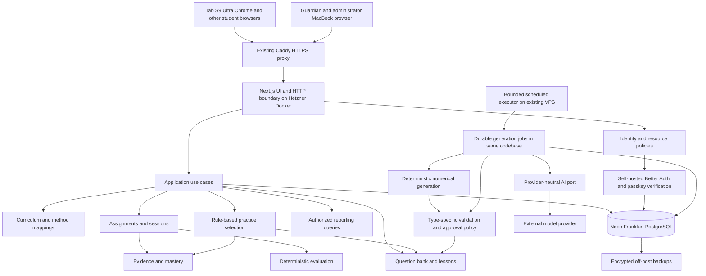
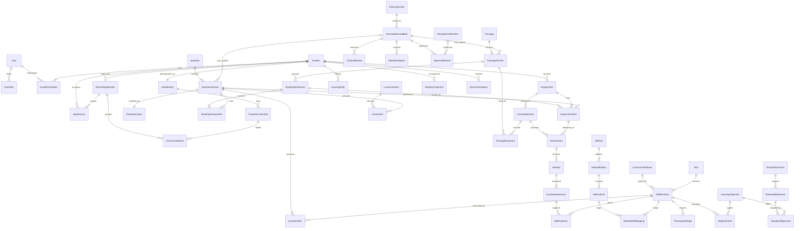
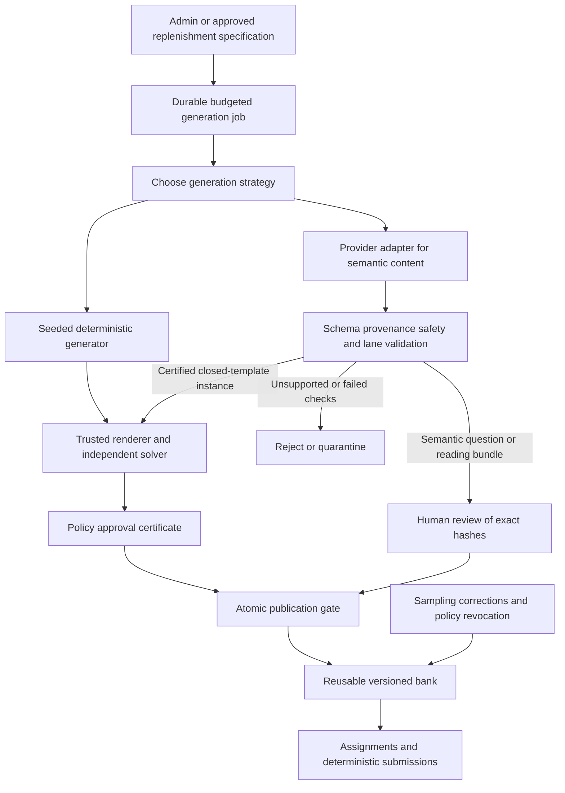

# nexo School — initial technical architecture

Date: 16 October 2026 · Revision 5 · Status: **Approved stack retained; auth spike accepted; foundation authorized**

Companion documents: [MVP scope and delivery milestones](../product/mvp-scope.md) · [Decision register](decisions.md).

## 1. Recommendation and repository findings

Build a **TypeScript modular monolith**: Next.js/React, Prisma and **Neon PostgreSQL in Frankfurt**, deployed on the existing **Hetzner VPS** behind HTTPS. Recommend Docker Compose and the existing Caddy reverse proxy, plus self-hosted **Better Auth** for adult and child authentication. A guardian enrolls child credentials/devices once; children then sign in independently using passkeys on approved browsers. The user reports a CPX22 with low recent utilization and a Tab S9 Ultra/Chrome; realistic concurrent-load capacity and passkey/browser behavior remain verification gates.

**AI-powered exercise generation is mandatory for the MVP**, introduced in the first end-to-end content/learning milestone. Publish instances of narrowly constrained, tested arithmetic templates automatically under a human-approved policy; route semantic language, word-problem and reading content through human review. Reuse published content and keep ordinary submissions independent of provider availability. Live tutoring remains optional.

Preserve the approved long-term foundations: publisher-independent skills, versioned content and historical attempts, separable mastery projections, explainable adaptivity, provider ports and future teacher/school boundaries. Five student categories share those foundations: Rekenen, Redactiesommen, Taal, Spelling and **Begrijpend Lezen**. Complexity is implemented in vertical slices; thousands of students are a future capacity objective, not a claim that the current shared VPS can serve them.

Revision 2 supersedes the Vercel/Supabase proposal, mandatory guardian launch for every session, four-category scope and post-MVP AI scheduling. Prior rationale and status changes are preserved in the [decision register](decisions.md).

### Historical repository inspection — initial planning

- Working directory: `/Users/elpridro/Documents/localDev/AI/nexo-school`.
- Branch: `main`; latest and only observed commit: `1778ad1 Initial commit`.
- Only tracked file before this proposal: `README.md`, containing `# nexo-school`.
- Working tree was clean. No package manifest, application, schema, tests, CI, deployment configuration, ADR convention, or applicable `AGENTS.md` was found in the repository or its ancestor chain.
- The first planning pass added these three Markdown documents; they remain untracked in Git at revision time. No application stack exists. The user approved the architectural direction but explicitly withheld implementation approval. This revision changes documentation only; no VPS, DNS, Neon project, credentials or deployment was accessed or changed.

### Requirements versus assumptions

**Confirmed requirements and decisions:** initial eight-year-old in groep 5; five student categories including passage-based comprehension; School and Growth modes; multi-role adults and resource-level isolation; AI generation within MVP; independent daily student access under guardian control; existing Hetzner VPS/domain/subdomain; Neon database, Free where suitable; deterministic evaluation; historical evidence; canonical skills and reviewed publisher mappings; future thousands of learners, teachers and schools. The 80–120 questions/day remain a workload example, never a mandatory target.

**Planning assumptions:** private household pilot, Dutch UI/content, online browsers, no child email, a limited but expandable groep-5 skill subset, an educational reviewer available for semantic content and template-policy approval. A stable HTTPS subdomain will become the passkey relying-party origin. Confirm these assumptions before production code.

**Known from user measurements on 13 October:** Hetzner CPX22 (`nexo-vps`), 2 vCPU, 4 GB RAM, approximately 2.5 GiB available, 80 GB SSD with approximately 51 GB free (30% used), Ubuntu 26.04 LTS, Docker and Caddy. CPU approximately 1–4%; nine containers reportedly used approximately 177 MiB combined. Swap is 2 GiB, with approximately 368 MiB used. Co-hosted workloads are Auctus frontend/backend, Minecraft relay, Student Planner, Word Atlas frontend/backend, Portfolio frontend/backend and Caddy. The student uses a Samsung Tab S9 Ultra with Chrome; guardian/admin uses a 16-inch M4 Pro MacBook. These are user-supplied observations, not independently remeasured in this planning session.

**Unknown:** exact Hetzner datacenter and representative peak load; isolation/patch settings; device OS/browser versions, lock/passkey settings and shared OS accounts; SMTP/backup/alert services; exact Malmberg methods, editions and current units; curriculum transition choice; reviewer availability; recovery objectives and incremental spend limits. No existing-server sufficiency or zero-cost operation is assumed.

## 2. Stack, deployment and operating model

| Area | Recommendation | Tradeoff |
|---|---|---|
| Language/runtime | TypeScript strict mode, supported Node.js LTS, pnpm | Shared contract vocabulary; runtime validation still necessary. Pin supported versions during implementation. |
| Web/API | Next.js App Router, React, Route Handlers, JSON REST `/api/v1`, Zod | One application; domain use cases stay independent of HTTP/React. |
| Database/ORM | Neon PostgreSQL `aws-eu-central-1`, Prisma, reviewed SQL constraints | Retains relational integrity and portability. Free quotas/cold starts require monitoring. |
| Authentication | Self-hosted Better Auth with Prisma adapter, passkeys and adult 2FA | Library handles passwords, WebAuthn and sessions; we operate patches and purpose-specific authorization. No custom crypto/password store. |
| Child access | Guardian-approved browser registration plus student passkey; hardware key option | Independent daily login with revocation. Browser registration is not proof of physical-device identity; see section 10. |
| Frontend | CSS tokens/Modules, accessible primitives, typed exercise renderers, local reducer | Preserve shared foundations; Storybook/global stores deferred until useful. |
| AI | Application-owned `ContentGenerator` port and one Anthropic adapter initially | Required early MVP pipeline; model choice follows Dutch educational evaluations and data terms. No SDK types in domain modules. |
| Background work | PostgreSQL durable generation jobs; bounded executor from the same application image | Required MVP capability. Scheduled bursts avoid a permanent polling loop; no broker/Redis. |
| Deployment | Docker Compose on existing Hetzner VPS; reverse proxy; HTTPS | Repeatable releases and limits, but OS/container/proxy security are our operational responsibilities. |
| Tests/CI | Vitest, Testing Library, PostgreSQL integration tests, Playwright/axe, GitHub Actions | Preserve focused educational/authorization/integrity tests; CI uses synthetic data. |
| Backups/monitoring/email | Encrypted off-host database/app backups; existing monitoring/SMTP if suitable | No paid monitoring platform by default; independent failure alerts and reliable recovery are still required. |

Vite/Fastify or NestJS would add another deployment/framework boundary without a current need. SQLite/document databases remain weaker fits for transactional history and relations. Prisma remains selected over Drizzle for schema/CRUD productivity, with SQL escape hatches. No browser database CRUD, microservices, Kubernetes, vector database or warehouse is introduced. Next.js supports self-hosted Node and Docker; its documentation recommends a reverse proxy. [Next.js self-hosting](https://nextjs.org/docs/app/guides/self-hosting).

### Deployment options and recommendation

| Option | Advantages | Costs/risks | Decision |
|---|---|---|---|
| Docker Compose, one app service and bounded job process using the same image | Reproducible runtime, explicit limits/networks, image rollback, aligns with later separation | Image/daemon updates, disk/log cleanup; shared kernel is not a VM boundary | **Recommended**, subject to host inventory |
| Node process managed by systemd, dedicated Unix user | Fewer container components; appropriate if host is already standardized on this | Runtime drift and dependency isolation require care; resource/security settings still required | Valid fallback if the host's existing operational model favors it; no ad hoc `nohup` process |
| Add a managed deployment platform or new VPS immediately | Easier separation in some cases | New expense and operating surface before capacity evidence | Defer; separate host if current workloads cannot be isolated safely |

Reuse the **existing Caddy container** and certificate-management setup; do not install a second proxy or disrupt other applications. Add only the future nexo vhost/network connection through the existing operational process. Caddy provides automatic certificate issuance/renewal. Point only the confirmed nexo subdomain at its vhost; verify DNS and renewal before redirecting HTTPS permanently. Choose one stable origin before passkey enrollment. [Caddy automatic HTTPS](https://caddyserver.com/docs/automatic-https).

Run the app as non-root with a dedicated Compose project/network, no Docker socket, no privileged mode, no unrelated host mounts, minimal capabilities, read-only filesystem where practical, bounded temporary/cache storage and CPU/memory/PID/log limits. Publish its port only on loopback or the proxy's private network. Restrict SSH to keys and approved management access; firewall public ports; test Docker/firewall interactions rather than assuming host firewall rules cover published ports. Keep secrets outside Git/images with restrictive permissions, and separate runtime, migration, auth, worker and backup credentials. A compromised root process on this VPS can still compromise nexo: do not co-host beside unmaintained or untrusted applications. [Docker security model](https://docs.docker.com/engine/security/).

Build immutable images in CI or a separate trusted builder matching the host CPU architecture, not during live traffic on a small shared VPS. Deploy by digest, run a serialized migration step with separate credentials, health-check, and switch proxy routing only after readiness. Keep the previous image for rollback; schema changes use expand/backfill/contract because image rollback cannot undo a destructive database migration. A short maintenance window is acceptable for the private pilot. No deployment files are created by this plan.

### VPS suitability — measure before concluding

| Verify | Initial planning envelope / acceptance evidence |
|---|---|
| CPU | Confirm vCPU count/architecture and peak CPU/steal load over representative days. Reserve roughly 1 vCPU burst capacity for nexo; throttle job concurrency to one initially. No model inference on VPS. |
| Memory | Confirm RAM/swap/OOM history and other apps' peaks. Budget roughly 0.5–1 GiB for the app plus 0.25–0.5 GiB during a job burst, with at least 0.5 GiB further safety headroom. These are test envelopes, not measured requirements. |
| Storage | Confirm free space/inodes and I/O latency. Allow 5–10 GiB for two release images, bounded logs and temporary backup staging, plus OS/other-app reserve; alert before 80% disk use. |
| Build/deploy | Verify x86/ARM artifacts, image registry access, double-image disk and temporary double-process memory if using overlap. Build off-host. |
| Network/location | Verify actual Hetzner EU datacenter, latency/TLS to Neon Frankfurt, outbound SMTP/API access, transfer limits and existing DNS/proxy ownership. |
| Isolation/maintenance | Inventory public services, shared volumes/users, Docker rights, patch cadence, kernel support, backup access, restart windows and responsible operator. |
| Workload | Test simultaneous learning submissions, one generation batch and backup activity alongside normal other-app traffic. No sustained memory pressure or regressions in co-hosted services. |

The reported 2-vCPU/4-GB CPX22, 2.5 GiB available memory, low sampled CPU and 51 GB free disk make reuse a reasonable pilot recommendation. The sample does not prove peak capacity. Existing swap use is not by itself failure, but measure ongoing swap-in/out and OOM events under load. Reserve roughly 1.5 GiB total for nexo app/job peaks initially and keep at least 0.5 GiB further headroom; throttle generation/backup work before allowing it to contend with learning and existing applications. Validate rather than reinterpret the reported container total as full-host memory consumption. If gates fail, tune/move jobs, improve isolation or approve a dedicated/expanded host before live child data. Thousands of students require separate load/concurrency evidence and probably additional app capacity; request count alone is not a sizing model.

Proposed pilot load gate: five synthetic concurrent learners submitting at human-paced intervals, one bounded generation job and a scheduled backup alongside representative existing-app traffic. Target warm deterministic submission p95 under one second; report cold-start latency separately and preserve correct retry behavior. Record peak RSS/CPU/I/O and swap-in/out, not just averages. These are initial test targets, not capacity or SLA claims.

### Database access, cost controls and availability

Use a dedicated Neon project in **Frankfurt**; its region is fixed at project creation, so verify it before storing data. Keep application and self-hosted auth tables private and server-accessed; do not enable the Data API. Use least-privilege non-owner runtime/auth roles and a separate migration role. Application resource policies remain mandatory. PostgreSQL RLS can be added deliberately with safe transaction-scoped context; a Prisma connection does not automatically inherit end-user identity. [Neon regions](https://neon.com/docs/introduction/regions).

Use TLS with certificate/hostname verification and the supported Prisma/PostgreSQL connection path. Runtime uses a small pooled connection budget shared sensibly between auth, requests and jobs; direct connections serve migrations and consistent logical dumps. Validate interactive transaction/pool compatibility with selected versions. No long provider calls inside transactions. [Neon connection guidance](https://neon.com/docs/connect/connect-from-any-app).

Neon Free is a **conditional private-pilot starting point**, not a production availability guarantee. At research time it includes 100 CU-hours/month/project, 1 GB storage/project and a short instant-restore window (up to 6 hours or 1 GB changes). Launch lists $0.106/CU-hour, $0.35/GB-month database storage and $0.20/GB-month retained change history; free allowances do not carry into paid usage. Recheck the console at provisioning. [Neon pricing](https://neon.com/pricing).

Observe database storage, compute, connections and egress; alert at 70% of quota and upgrade/reduce optional work before 90%. Paid autoscaling limits constrain compute rate, not total monthly spend. Never stop recording an in-flight answer to enforce an AI budget. Document Free quota exhaustion behavior and a manual upgrade contact; return a recoverable error rather than claiming a failed write saved. An idle wake may make the first request slower; measure warm and cold latency separately. [Neon scale to zero](https://neon.com/docs/introduction/scale-to-zero).

Do not poll the database every minute for jobs, health checks, session refresh or dashboard updates. Use application liveness checks without DB queries, checks on real requests, and a few bounded scheduled generation/recovery windows per day. An admin request can enqueue work for the next window; show that delay. A wake signal may improve latency but the durable DB job remains the source of truth. Each burst exits when empty or out of time; failed leases recover on the next scheduled run. At 0.25 CU, 24/7 wakefulness is about 180 CU-hours in 30 days, already above the Free compute allowance.

### Backup and restoration plan

**Targets to approve:** off-provider disaster-recovery RPO at most 24 hours and RTO one working day for the private pilot; a failed daily backup breaks the RPO and must alert outside the VPS. Paid instant restore can improve recent-error recovery, but is not a substitute for independent backups.

1. **Neon database:** daily consistent `pg_dump` of application, content, job and self-hosted auth schemas using compatible PostgreSQL tools and a scoped backup role. Include all required sequences/schema objects; preserve role/grant definitions as reviewed metadata without exporting unnecessary role passwords. Encrypt before upload to an off-VPS EU backup destination; verify exit status, size and checksum. No plain dumps in logs, public buckets or general CI artifacts. Keep 30 daily copies maximum under the proposed privacy retention policy.
2. **Application:** Git and immutable image digests recover code; separately back up deployment manifests, dependency lockfile, proxy/vhost settings, content assets if introduced and an encrypted secrets recovery bundle. Keep recovery keys outside the VPS and outside the archive they unlock. App containers remain stateless; their cache is disposable. A Hetzner server snapshot alone does **not** back up the external Neon database.
3. **Destination:** reuse an existing independent encrypted backup service if its access, retention and capacity fit. Otherwise allocate a small paid EU destination, such as Hetzner Storage Box with a restricted subaccount and client-side encryption. A separate service under the same vendor/account protects against host loss but not every account-wide compromise; keep a periodically refreshed encrypted copy/keys in separately controlled storage too. Prefer deletion-resistant/snapshot controls that the app cannot erase. [Neon backup strategies](https://neon.com/docs/postgres/backup-restore/backups), [Storage Box capabilities](https://www.hetzner.com/storage/storage-box/).
4. **Restore drill:** before live data, and quarterly thereafter, restore into an isolated EU database/host; disable email/AI/jobs; apply the current deletion and access-revocation ledger; invalidate restored sessions, pending enrollments and reset tokens; preserve revoked credentials as revoked. Verify counts, FKs, sampled attempts, evaluation hashes and mastery rebuild. Then test login with newly issued sessions and the critical learning flow. Never use an unfiltered production branch as a preview.
5. **Incident cutover:** select PITR/backup recovery point, stop writes, restore and verify, rotate compromised secrets, update connection settings, then reopen traffic. Document the actual lost-write interval. Store deletion/revocation records outside the database recovery point so restoration cannot resurrect erased data or lost-device access; expire ledger entries after all relevant backups expire.

### Incremental cost model

Existing VPS rental and existing domain renewal are **already-paid baseline costs**, not new nexo charges. Shared CPU/RAM/traffic still consume capacity and operator time. The earlier €60 fixed-infrastructure budget is withdrawn. Figures below are planning estimates before tax/currency conversion, not a vendor quote or permission to buy services.

| Incremental item | Private pilot | Trigger / later growth |
|---|---|---|
| VPS/domain allocation | €0 additional if verified spare capacity and current domain suffice | An upgrade/dedicated host is a separate quoted delta; never assumed free at thousands of students. |
| Neon database | $0 while comfortably within Free limits; roughly $5–25/month for a small paid workload | Measure CU-hours, storage/history/egress; approve paid use before quotas threaten saved work. |
| Off-host encrypted backup | €0 if existing suitable capacity; otherwise budget €4–6/month pending actual location/VAT quote | Retained size, independent copy and backup transfer increase with data. |
| Transactional email | €0 with suitable existing SMTP/low-volume allowance; otherwise budget €0–5/month | Authenticate domain with SPF/DKIM/DMARC, test delivery and quotas; no new self-hosted mail server. |
| Monitoring/TLS/assets | €0 software/certificate fee with existing tools; reserve €0–2/month if an independent alert/check needs it | Text/passages in PostgreSQL initially; no image/audio bucket until a real need. |
| AI APIs, separate | Initial planning allowance $5–20/month after seeding; proposed hard cap $20 plus explicit seed/evaluation allowance | Depends on new content, rejection, token size and model; submissions/reuse cost no AI calls. |

**Ordinary pilot infrastructure estimate:** approximately €4–13/month incremental with Neon Free and a newly needed backup destination; as low as €0 if adequate backup/email/monitoring already exist. Add Neon paid usage in USD when needed; do not hide it in an assumed exchange rate. Existing server cost and human review/operations time are excluded and should be recorded separately. Hetzner's page did not expose a reliable location/VAT-specific numeric quote to this research pass, so the backup line is an allowance, not a claimed list price.

For transparent paid examples, using the researched Launch rates: 30 CU-hours + 1 GB data + 1 GB history ≈ **$3.73/month**; 180 CU-hours + 5 GB data + 5 GB history ≈ **$21.83/month**; 720 CU-hours + 10 GB data + 10 GB history ≈ **$81.82/month**. These omit excess egress/branches and tax. They are workload scenarios, **not promises for a particular student count**. For a growing multi-family pilot budget $20–100/month database usage until measured; a 1,000-student rollout needs a load/storage model, independent host quote and recovery review before a credible total exists.

AI example: 100 batches/month × (2,000 input + 4,000 output tokens), using an illustrative $1/$5 per million token rate, costs $2.20 before retries/review calls; tripling the rate gives $6.60. Haiku 4.5 currently lists that lower rate, but model selection depends on quality, not this example. Passage sets use more tokens; template variations often need no further model call. Track cost per **published usable item/set**, rejection rate and review minutes. [Anthropic pricing](https://platform.claude.com/docs/en/about-claude/pricing).

At 120 submissions/day, one student produces about 43,800 submissions/year. At 1,000 such students that is 43.8 million/year: preserve pagination, ownership indexes and projection boundaries now; consider partitioning, workers/outbox, reporting replicas and organization scoping only when the corresponding measured need/rollout arrives. Keep the ambitious model without prematurely deploying its entire infrastructure. As an explicit growth budgeting scenario, 43.8 million annual submissions at an assumed 2–5 KB of total learning rows per submission require roughly 88–219 GB before indexes, extra replicas/history and shared content; measure actual row size early. For example, 720 CU-hours + 200 GB data + 50 GB history would be about $156.32/month at the cited Launch rates. That is an illustrative database workload after growth, not a 1,000-student capacity guarantee or a total operating quote; any VPS upgrade, backup/email growth and AI remain separate.

## 3. System architecture and module boundaries



The diagram groups use cases; all persistence occurs through server adapters. These are folders and ownership boundaries in one application, not independent microservices; a bounded job process runs the same image without occupying the HTTP process. Calls within the monolith are ordinary typed function calls. No internal HTTP, event bus or general-purpose repository framework.

| Module | Owns and responsibilities | Public application interface | Allowed dependencies |
|---|---|---|---|
| Identity and Access | Adult/child identity links, roles, credentials, browser grants, sessions and revocation | `authenticate`, `authorize`, `approveEnrollment`, `revokeDevice`, `requireRecentAdultAuth` | Auth/session adapters; supervision relationship reader |
| Students and Guardians | Student profile, grade history, active/revoked supervision links, preferences | `createStudent`, `grantSupervision`, `revokeSupervision`, `getStudentScope` | Identity actor types; storage |
| Curriculum and Skills | Releases, domains, objectives, skill hierarchy, prerequisites, standards references | `getSkill`, `getPrerequisites`, `validateRelease` | Storage only |
| Educational Methods | Publisher/method/edition/unit metadata and reviewed mappings | `resolveUnitSkills`, `reviewMapping` | Curriculum |
| Question Bank | Question/template/passage/set versions, lesson versions, rights, approval policies and publication | `getStudentPresentation`, `getPassageSet`, `getEvaluationSpec`, `findEligibleItems`, `publishVersion` | Curriculum, rights/review records |
| Assignments and Sessions | Plans, assigned snapshots, item order, session state, retry policy | `assignWork`, `startSession`, `nextItem`, `submitAnswer`, `finishSession` | Content, methods, access, evaluation, progress; selection through a narrow interface |
| Answer Evaluation | Response parsing, exact checking, step scores, misconception codes | `evaluate(spec, response, policy)` | Pure types and deterministic evaluators only |
| Progress and Mastery | Evidence projections, mastery versions, calculation policy | `recordEvidence`, `rebuildMastery`, `getSkillState` | Immutable attempt/evaluation inputs, curriculum identifiers |
| Adaptive Learning | Rule-based candidate ranking and reason codes | `proposePractice(context, evidence, catalog)` | Curriculum, progress and content read interfaces; no assignment writes |
| AI Content Generation | Generation specs/jobs, prompt/model metadata, validation reports, automatic approval and semantic review | `requestGeneration`, `validateCandidate`, `approveUnderPolicy`, `reviewCandidate` | AI provider port, content/curriculum public interfaces; no student-record reader |
| Reporting | Authorized performance views, mode comparisons, export | `getProgressReport`, `exportStudentHistory` | Read interfaces/views; never owns grading or mastery logic |

Each table has one writing module. Cross-module reads use narrow exported services or authorized reporting projections. Cross-module learning writes share one database transaction through a small application transaction coordinator. Avoid exposing Prisma-generated types, HTTP objects or SDK responses in domain interfaces. Pass time and randomness as inputs where needed to make educational logic reproducible.

Planned directory layout, **not a scaffold created by this proposal**:

```text
src/
  app/                     # student, guardian, admin routes and /api/v1 handlers
  modules/
    identity/              # public.ts, policies, application services
    students/
    curriculum/
    methods/
    content/
    learning/
    evaluation/
    progress/
    adaptive/
    ai-content/
    reporting/
  contracts/               # safe request/response schemas; no answer keys
  infrastructure/          # Prisma, auth provider, AI provider, job execution
  ui/                      # tokens, primitives, exercise renderers, report components
  server/                  # composition root, server-only bindings, transaction boundary
prisma/                    # schema and reviewed migrations, when implementation begins
tests/                     # integration, e2e, synthetic fixtures, educational gold cases
docs/                      # architecture and product decisions
```

Add `domain/` and `application/` subfolders when a module becomes large enough to need them; do not manufacture layers in every small folder. Enforce module entry-point imports and prohibit UI importing persistence/evaluation specifications through lint rules.

## 4. Canonical curriculum and educational content

### Separate navigation from assessed knowledge

Student categories are **Rekenen, Redactiesommen, Taal, Spelling and Begrijpend Lezen**. Canonical curriculum subjects initially are **Rekenen/wiskunde** and **Nederlands**. Spelling is a Nederlands domain; Redactiesommen is a presentation/practice category that can assess mathematical modelling and calculation, with reading demands recorded separately. Begrijpend Lezen is a separate practice category mapped to Nederlands reading-comprehension skills. Categories are many-to-many tags, not duplicate skill trees.

Example of original content: “Er zijn 6 zakjes met elk 4 knikkers. Hoeveel knikkers zijn er samen?” A three-step version asks for the operation, calculation and unit. A question may map to `math.model.equal-groups` and `math.multiply.basic`. A correct final number alone is weak evidence for the modelling step and **no proof of reading mastery**. Mark skills as `assessed` or `supporting`; supporting skills receive no mastery credit. Distinct observed steps may provide evidence for distinct skills. Without separable observations, use one primary assessed skill in the MVP and show the rest as context.

### Structure and versions

- `CurriculumRelease`: immutable published release, identifier, locale, reviewer and publication date. Draft releases may change.
- `Subject` → `Domain` → `SkillRevision`: stable skill identity with release-specific wording, parent, prerequisites and difficulty rubric. Subskills use `parentSkillId`; prerequisite edges form a validated DAG within a release.
- `GradeBand`: groep 1–8 metadata; `SkillGradeExpectation` relates skills to expected grade ranges. Grade suggests scope, not a hard ability restriction. Track student grade changes separately from attempts.
- `LearningObjective`: an observable educational outcome linked to one or more skill revisions. Avoid conflating a broad statutory goal with an automatically testable question.
- `DifficultyBand`: ordinal within a skill, described by task features (number range, operations, abstraction, reading load, support). A level 3 spelling item is not numerically equivalent to level 3 arithmetic. Store reading load independently.
- `StandardsFrameworkVersion` and `StandardReference`: source URL/document version, code, legal/publication status and effective dates. `StandardAlignment` links objectives to standards with reviewer and evidence.
- `Publisher` → `Method` → `MethodEdition` → `MethodUnit`, with optional parent units for year/book/block/week. `MethodSkillMapping` links an exact unit/edition to a skill revision/objective; record mapping type (`teaches`, `practises`, `assesses`), provenance and review status.

Use stable UUID identities plus human-readable codes. A typo fix in published curriculum creates a revision; a substantive split/merge creates new skill identities with explicit `replaces`/crosswalk relationships. Do not silently transfer past mastery across changed skill meanings. Historical evidence keeps its original revision. An approved crosswalk may feed a separately versioned new projection, marked as transferred evidence.

### Dutch standards and Malmberg

As of this proposal, new Nederlands and rekenen/wiskunde kerndoelen took effect on **1 August 2026**, with transitional provisions allowing established schools to continue using earlier goals until **1 August 2031**. Therefore, record both the standards version and the school's chosen alignment. Do not label all new goals “draft” or assume the initial school has migrated. This does not establish a complete groep-5 progression: an educational reviewer must turn broad goals into teachable skills. [Official decree, commencement and transition provisions](https://zoek.officielebekendmakingen.nl/stb-2026-198.html), [SLO curriculum update](https://www.slo.nl/thema/meer/actualisatie-kerndoelen-examenprogramma/actualisatie-kerndoelen/).

Until the exact Malmberg methods and editions are known, School Mode uses guardian-selected canonical skills and an optional school-unit label, explicitly marked **guardian-described alignment**. Do not invent method names, ingest a guessed edition, or advertise verified Malmberg alignment. Once identified, review a small unit mapping before expanding.

Mapping states: `suggested → in_review → verified | rejected`, with later `withdrawn`. Record whether suggested by a person or AI, source evidence, reviewer, date and reason. AI confidence is not educational verification. Assignments pin the mapping version actually used. Changes affect new assignments only.

### Copyright and provenance

Every question version has `origin` (`original_human`, `original_ai_assisted`, `licensed`) and a `RightsRecord` containing owner, source reference where relevant, license/permission evidence, allowed use and expiration if any. A reference to a publisher objective is different from permission to reproduce an exercise. Do not upload textbook pages, copy exercises, or ask AI to paraphrase protected pages without verified rights. Default to original questions against canonical skills. Human review includes originality and rights; model output is not proof of copyright clearance. License expiry/withdrawal prevents future serving while access to historical material follows the applicable rights decision.

## 5. Exercise engine and state transitions

### Small typed plugin boundary

Each supported question type supplies a public presentation schema, response schema, server evaluation-spec schema, pure evaluator and UI renderer. Register these in code; no arbitrary evaluator scripts stored in the database. Keep `contentSchemaVersion`, `evaluatorVersion` and `rubricVersion` explicit. The public question is a whitelist projection, not a question row with a few fields removed.

| Type | MVP evaluation behavior | Important boundary |
|---|---|---|
| Multiple choice | Compare submitted option ID against server key | Stable IDs survive shuffled display order; client supplies no correctness flags. |
| Numerical | Parse locale-aware decimal/rational strings, enforce expected unit, exact comparison by default | Dutch decimal comma supported; reject ambiguous grouping. Do not use JavaScript floating-point equality for fractions/decimals. Tolerance is explicit per item, not global. |
| Short written | Versioned normalization + finite, reviewer-approved accepted answers | For spelling, do not strip accents or forgive spelling mistakes. Case sensitivity is objective-specific; do not assume all short answers can be checked reliably. |
| Fill in the blank | Evaluate each named blank using its declared evaluator | Per-blank evidence and rubric; order/partial credit explicitly specified. |
| Multi-step word problem | Compose supported response types and evaluate each observed step | Steps become locked when submitted. Preserve hinted/assisted status and avoid awarding the same evidence twice. |
| Passage-linked comprehension | Existing choice/finite-text evaluators, with a set-level reveal policy; evidence selection encodes stable text anchors as option IDs | Passage/set/question versions must match; semantic correctness is reviewed before publication. |
| Future interactive | New schemas, evaluator and renderer using the same lifecycle | Drag/drop, number line, speech and handwriting are deferred. No open-response AI grading in the MVP. |

All responses are size-limited and schema-validated. Store original and normalized response server-side, evaluation outcome (`correct`, `incorrect`, `partial`, `unscorable`), step results, score in [0,1], approved feedback code, and deterministic misconception tags where a known distractor/error supports one. Unknown mistakes stay unknown; do not invent a diagnosis. Invalid syntax returns a validation error without creating a scored attempt. Valid but unscorable work is recorded and excluded from mastery.

### Content, lessons and templates

A question is a stable identity; each published version freezes prompt, response schema, evaluation spec, assessed skills, rubric, rights and approved explanations. Workflow: `draft → validated → approved → published → retired/quarantined`, with `in_review` required for semantic content and policy approval permitted only for certified template instances. `rejected` never transitions directly to publication. Store lifecycle changes in separate records so published payloads remain immutable. Editing a published item creates a new version. Retired items are unavailable for new work; quarantined incorrect/unsafe items also stop pending sessions and trigger a correction review.

A lesson version is a small ordered collection: learning objective, original explanation/worked example, approved question references and completion rule. It is not a course-authoring system. Assignments can reference a lesson version or a selected exercise set.

Templates are versioned, constrained parameter generators. Each materialized instance pins template version, seed, parameters, presentation, evaluation data and an approval certificate. Routine numerical variations come from a seeded deterministic parameter generator: no AI request or token spend. AI can help draft new exercise families or semantic content when that adds value; trusted code renders certified wording and independently computes answers. A human approves each template/policy version, not every numerical variation. Test all finite parameter combinations for the initial narrow auto-approved families, plus renderer/evaluator independence and boundary invariants. An arbitrary AI-authored template or semantic wording change is never executable or automatically approved. MVP language, word-problem and reading candidates require the semantic review lane in section 9.

### Passage-based Begrijpend Lezen

A passage is reusable content, not a string copied into each question. `Passage` has immutable `PassageVersion` records: Dutch title/body with stable paragraph/sentence anchors, author/origin and rights, intended grade/reading band, word count, vocabulary and syntactic demand, genre, topic, publication/review state, content hash and optional accessibility metadata. A claimed AVI or other formal reading level needs a justified assessment method; do not treat an AI label or word count as certification. Use a local rubric and mark estimates until reviewed. The reading-level metadata and its validation status are versioned independently of the student's grade.

`ReadingSetVersion` pins exactly one passage version and an ordered list of `ReadingSetQuestion` entries referencing question versions, assessed skill, evidence anchors, answer rationale and reveal dependencies. A passage may support many sets; a question can have distinct reviewed links to a passage. A changed passage creates a new version and requires revalidation of every linked question/rationale before a new set is published. Assignments pin the entire set version; a composite FK/version check prevents presenting questions against a different passage revision. Quarantining a passage blocks all dependent pending sets.

Initial canonical comprehension skills include main idea, relevant details, conclusions, cause/effect, extracting/interpreting information, vocabulary in context, author's purpose and inference. Keep grade/difficulty expectations separate for passage complexity and question reasoning. Multiple choice, constrained short answers and evidence-selection by stable text anchor reuse existing evaluators. Subjective unrestricted written interpretation remains outside automated MVP scoring; draft explanations/rationales are reviewed before publishing.

The learner reads the passage alongside or before the questions with persistent access to the text and accessible mobile/tablet navigation. Default: commit all first responses in a set before revealing explanations that could answer another question. A correctness hint/reveal that leaks information marks dependent later responses assisted. Reading time is measured once per passage exposure, then question time separately; do not multiply the passage time across every question or use reading speed as ability. Saved sessions resume at the same passage/set version.

Multiple questions on the same passage are correlated evidence: record each question/step, but use `passageVersionId` as the family cluster. Aggregate at most one mastery observation per skill/passage exposure (mean of eligible question scores); a revised near-identical passage retains its root family ID. Per-question evidence remains immutable; the per-exposure aggregate is derived/rebuildable and becomes eligible only when the first-response phase closes, so later answers do not overwrite earlier facts. Require diverse passages and days for a secure signal, not eight questions from one text. Track prior passage exposure/re-reads separately from novel comprehension.

AI generates an original passage plus a bounded question set and text-grounded rationales as one candidate bundle. Validate schema, anchors, answerability, uniquely defensible keys, reading difficulty and rights; humans approve semantic correctness for the exact bundle in MVP. Numeric correctness inside a story does not prove its meaning. No publisher-page uploads or close paraphrase requests without verified rights. A whole reviewed set supplies multiple usable exercises, amortizing review while retaining question-level evidence.


### Learning lifecycle

| Object | States and rules |
|---|---|
| Learning plan | Editable guardian preferences: focus skills, mode, session size, support level. Save a version/snapshot when used; daily quotas are optional and off by default. |
| Assignment | `draft → assigned → completed | cancelled`; due/overdue is derived. Assigned content and policy are frozen. Revisions create a replacement assignment. One student per assignment; bulk issuance can be added later. |
| Session | `active ↔ paused → completed | abandoned`; assigned work may span multiple sessions. A partial unique constraint allows one active session per student initially. Resume the existing session rather than create duplicates. |
| Session item | `pending → presented → resolved | skipped | withdrawn`; pins concrete question version/instance and presentation order. A new session resumes outstanding assignment items rather than silently reissuing completed work. |
| Attempt | One valid submitted response, append-only. Submission and evaluated result commit atomically. An HTTP replay is not a new attempt. A pedagogical retry is a new attempt with the next sequence number. |
| Evaluation correction | New evaluation revision referring to the original attempt and previous evaluation. Original record remains; derived evidence uses only the current valid evaluation revision. |

Historical retry proposal (superseded on 17 October 2026 for timing and session scoring; see [weekly practice requirements](../product/weekly-practice.md)): at most two valid submissions per item/step. After the first incorrect response, show a reviewed hint and allow one retry. After success or the second response, reveal the worked explanation and close that step. The first unassisted submission is the primary mastery observation; retries measure learning-with-support separately. Showing a hint before any submission marks that observation assisted. Revealing an answer closes that item for mastery purposes. For reading sets, defer correctness/key/explanation feedback until all first responses are committed, overriding this per-item reveal default; any earlier reveal taints dependent evidence as assisted. These are pedagogical defaults to approve, not research-backed universal thresholds.

Current default: two valid attempts per original question, with first misses queued after the original questions, the exact same question on retry, and session points of 1 / 0.5 / 0 for first-try correct / second-try correct / wrong twice. A second miss receives a worked explanation. Ten-question sessions apply to Rekenen, Redactiesommen, Taal and Spelling; a whole reading task defines its own session length. The guardian weekday plan repeats automatically, while question selection supplies fresh or deliberately reviewed work. See the linked requirements for remainder/spacing details and the preserved reading assistance rules.

Completing an assignment means every item is resolved or explicitly skipped; it does not mean every answer is correct. Reports distinguish completion, skips and first-attempt accuracy. An abandoned session preserves all committed attempts and leaves unresolved assignment work resumable. Quarantined items become withdrawn and visible to the guardian; replacement work is explicit.

## 6. Data model, ownership and integrity

This is a logical model, not a mandate to create every table in milestone one. Shared content is global; personal learning records belong to a student. Adult users may supervise multiple students, and a student may have multiple guardians. A household is not an implicit authorization boundary.



The ERD omits supporting fields/joins for readability. `PrerequisiteEdge` has both prerequisite and dependent revision FKs. `SkillEvidence`, `PassageExposure` and every student-derived projection carry `studentId`. `AppSession` is the domain view of a library-managed session plus its authorization context, not a second homemade token implementation. `AssignmentItem` represents either a standalone question instance or a pinned reading-set group with child question items; enforce the tagged-reference XOR and ordered membership. An `AppSession` has exactly one adult user principal or student principal, never both. The guardian relationship is required at creation, but retaining a student record while all links are revoked can be necessary during deletion/recovery; the conceptual “has guardian” cardinality is not an unconditional database cascade rule.

| Owner / entities | Important stored facts and constraints |
|---|---|
| Identity: `User`, `AuthIdentity`, `UserRole`, `AppSession`, `PasskeyCredential`, `DeviceRegistration`, `DeviceCredential`, `EnrollmentRequest` | Unique identity subject and credential ID; adult-only multi-role grants; library-managed credential/session storage, never custom hashing/crypto. Student identity maps to exactly one student. Browser-grant hash, enrollment expiry/consumption, approved credential binding and revocation are server-controlled. A session must match both registration and principal. |
| Students: `Student`, `GuardianStudent`, `StudentGradeHistory` | Pseudonymous display name, locale, grade; unique active user/student link; relationship status and capabilities (`view`, `assign`, `manage`). Revocation audited and checked on every request. |
| Curriculum entities | Unique release/code, immutable published payloads, no self-edge/cycle, same-release references, explicit crosswalks. Mappings carry provenance and exact edition. |
| Content: `Question`, `QuestionVersion`, `EvaluationSpec`, `QuestionSkill`, `TemplateVersion`, `QuestionInstance`, `LessonVersion`, `RightsRecord` | Unique `(questionId, version)`; server-only key storage; published content hash; each assessable item has at least one assessed skill; supporting skills have zero evidence weight. Instances pin generator/seed. |
| Reading content: `Passage`, `PassageVersion`, `ReadingSetVersion`, `ReadingSetQuestion` | Unique version/hash; reading-rubric metadata and rights; ordered question links and evidence anchors tied to exact passage revision; publication validates all dependencies atomically. |
| Learning: `LearningPlan`, `Assignment`, `AssignmentItem`, `LearningSession`, `SessionItem` | Student ownership, mode, immutable selection/mapping snapshot, ordered items, item/assignment revisions, planned and actual support; pinned passage/set references and passage-exposure IDs where applicable. One active session per student; session references assignment with the same student. |
| Evaluation: `Attempt`, `EvaluationRevision`, `ItemInteraction` | Raw response, normalized response, received time, response schema version, server sequence, evaluator/rubric version, hint/answer-reveal events. Unique attempt client ID within session and unique sequence within logical assignment item/step. |
| Progress: `SkillEvidence`, `MasteryProjection`, `Recommendation` | Source evaluation/step/skill, passage/template family, eligibility and weight; unique evidence source; projection algorithm version and processing cursor; recommendation reason, candidate IDs, expiry and overrides. |
| AI/content review: `GenerationJob`, `GeneratedCandidate`, `ContentReview`, `ValidationReport`, `TemplateCertification`, `ApprovalRecord` | Idempotency key, prompt/schema/provider/model versions, redacted input hash, usage/cost, validation versions/results, human-or-policy authority, certificate dependency and exact content hash. Changed payload/certification requires fresh approval; semantic bundles cannot use the automatic lane. |
| Operations: `AuditEvent`, `ConsentRecord`, `DeletionRequest`, `AccessRevocationLedger`, `IdempotencyRecord` | Security/content actions, consent purpose/notice version where applicable, deletion execution state, durable mutation replay metadata. Do not put answer text or authentication secrets in audit logs. |

### Immutable facts versus editable state

Published content/curriculum payloads, assigned snapshots, submissions, evaluation revisions and review decisions are historical facts. Corrections append records, quarantine affected content and rebuild projections. Editable state includes draft content, profile preferences, active permissions and current session status. Mastery, progress counters and recommendations are derived and replaceable. This is a conventional relational system with immutable records where useful, not full event sourcing.

“Immutable” applies to normal product operations, **not indefinite retention**. Authorized privacy deletion must remove personal responses, evidence, exports, sessions and derived data according to the retention policy. Keep a non-identifying deletion receipt if needed; do not leave a student-linked tombstone forever. Shared original questions can remain when they contain no personal data.

### Transactions and concurrency

`SubmitAnswer` runs one short database transaction: authenticate and authorize; lock the logical assignment item/step; check session state, item revision, retry allowance and idempotency; load pinned evaluation specification; run deterministic evaluation; insert attempt and evaluation; insert eligible evidence; update mastery projection and item completion; store the safe replay response; commit. Lock affected mastery rows in stable skill-ID order to avoid deadlocks. Serialize concurrent submissions on the same logical assignment item, including across resumed sessions. Provider calls never occur inside this transaction.

For a bounded content set, synchronous projection updates avoid queue failure modes and give immediate consistent reports. They are reconstructible from valid evaluations. Later, heavy projections can move to a transactional outbox with unique event IDs, idempotent consumers and visible lag; do not introduce that infrastructure now.

Every command that creates work accepts an idempotency key, scoped to actor and operation with a payload hash. Same key/same payload returns the original result; same key/different payload returns `409`. Persist `clientAttemptId` with the attempt for its lifetime, so expiry of a general replay cache cannot create a duplicate historical answer. Concurrent different keys for the same item revision produce one committed answer and one `409 STALE_ITEM`. Prisma transactions support atomicity, but unique database constraints and explicit concurrency control are still required. [Prisma transaction guidance](https://docs.prisma.io/docs/orm/v7/prisma-client/queries/transactions).

Use FK constraints with restrictive deletion on referenced content. Composite ownership references prevent connecting a student's session to another student's assignment/item. Add checks for scores [0,1], positive sequence, bounded weights and valid principal shape. Use application validation plus database constraints; neither alone is sufficient. Database ownership protections should prevent routine updates/deletes of immutable payload tables; a separately authorized maintenance path handles corrections and privacy erasure.

Indexes initially: active guardian/student lookup; `(studentId, createdAt, id)` for assignments and sessions; `(sessionItemId, sequence)` for attempts; `(studentId, skillRevisionId, observedAt)` for evidence; unique `(studentId, skillRevisionId, algorithmVersion)` for mastery; `(status, availableAt)` for jobs; edition/unit and skill mappings; published question-skill eligibility. Use cursor pagination for history. Start with normal indexed queries, not partitioning or a warehouse.

Migrations are reviewed, committed and exercised on an empty database and a prior-version synthetic fixture. Use expand/backfill/contract for incompatible changes. Back up before risky migration, test restoration, and record the schema version with deployments. Do not edit already-applied migrations or silently change published evaluator semantics.

## 7. Core workflows and representative contracts

### Assign work

1. Guardian authenticates; server resolves active supervision and `assign` capability for the target student.
2. Guardian chooses a plan/lesson, category, mode, desired length and skills. In School Mode, a verified edition/unit mapping can resolve skills; otherwise the guardian selects skills and the alignment is labelled unverified.
3. The selector returns eligible published items with rights, skill and difficulty checks. Growth Mode uses the rule policy below. Preview includes count, objectives, coverage gaps and reasons, but no new generated questions.
4. Guardian confirms the preview (or a student requests a set within an already approved, versioned plan). Server revalidates its content hashes, access and current publication status, then atomically writes the assignment and ordered items. If content was withdrawn, reject and refresh the preview rather than silently substituting it.
5. For student-initiated practice, server obtains the student from the session and constrains count, skills, mode and schedule to the guardian plan; the child cannot submit broader permissions.
6. Assignment records selection policy/version, curriculum release, learning-plan snapshot and method-mapping version. Later changes cannot rewrite the assigned history.

### Complete work and update progress

```mermaid
sequenceDiagram
  participant S as Student browser
  participant H as HTTP boundary
  participant L as Learning service
  participant E as Pure evaluator
  participant D as PostgreSQL
  S->>H: Start or resume authorized assignment
  H->>L: actor and validated command
  L->>D: Check ownership and pin session items
  L-->>S: Public question DTO and item revision
  S->>H: Response, clientAttemptId, expected revision
  H->>L: Authenticated submission
  L->>D: Begin transaction; lock item; deduplicate
  L->>E: Pinned server spec and response
  E-->>L: Outcome, step scores, feedback codes
  L->>D: Insert attempt, evaluation, evidence; update mastery/item
  D-->>L: Commit
  L-->>S: Safe feedback, new revision, next action
  Note over S,D: Retrying the same network request returns the saved result
```

A failed commit returns a retryable error without showing success. The client retains the unsent response in memory until acknowledged and retries with the same ID. Reload fetches committed state. MVP is online-only: no background offline submission queue, persistent browser answer history or service-worker cache of private data. If the network disappears, explain the state and permit retry; do not pretend progress was saved.

### API conventions

REST adapters are thin; all routes and server-rendered reads use the same use cases and authorization policies. UUIDs are opaque identifiers, never authorization. The authenticated actor comes from a verified server session; callers cannot submit `guardianId`, `role`, `score`, `correctAnswer` or evaluation versions as authority.

Use versioned Zod request/response schemas and generated or checked OpenAPI contracts. Reject unknown fields on sensitive commands. Times are ISO-8601 UTC; dates such as school deadlines include explicit `Europe/Amsterdam` interpretation. Decimal answers travel as strings. Cursor-list responses have `items` and `nextCursor`, with server maximum page size. Responses containing personal or unrevealed content use `Cache-Control: private, no-store`.

| Route | Input boundary | Output and authorization |
|---|---|---|
| `POST /api/v1/students` | `displayName`, `grade`, `locale`; bounded values, no DOB required | Student ID; verified guardian; creates supervision atomically. |
| `POST /api/v1/enrollments` | Browser-bound request; no account enumeration | Expiring pending transaction; no learning/admin session yet. |
| `POST /api/v1/students/{id}/enrollments/{enrollmentId}/approve` | Confirmation code and expected revision | Guardian `manage` scope + fresh MFA; one-use approval for that browser/student. |
| Library auth/passkey registration and sign-in routes | WebAuthn challenges/assertions through supported library handlers | Registration requires approved enrollment; login requires active credential + approved browser; never client-chosen role. |
| `GET /api/v1/students/{id}/devices` and `POST .../devices/{deviceId}/revoke` | Student/device ID; fresh adult auth for revoke | Guardian sees labels/last use, revokes matching grants/sessions; no credential secrets returned. |
| `POST /api/v1/me/practice-sessions` | Guardian plan ID/revision, idempotency key | Server creates assignment/set within approved bounds for current student, using published bank; no AI wait. |
| `POST /api/v1/assignment-previews` | `studentId`, mode, category, skill IDs or exact method-unit mapping, count | Preview ID/hash, safe item summaries, reasons and gaps; guardian scope. |
| `POST /api/v1/assignments` | Preview ID/hash, optional due date; idempotency header | `201` assignment ID/revision/count; revalidate content and scope. |
| `GET /api/v1/me/assignments` | Optional status/cursor | Only the current student's assignments in child mode. Guardian listing is explicitly student-scoped. |
| `POST /api/v1/assignments/{id}/sessions` | Expected assignment revision; idempotency header | Existing active session or newly created session plus current item; student owns assignment. |
| `GET /api/v1/sessions/{id}/current-item` | Session ID | Public presentation and pinned passage/set metadata where relevant, response type, item revision, feedback policy; never evaluation spec or unrevealed evidence rationales. |
| `POST /api/v1/sessions/{id}/attempts` | Session item ID, response union, expected revision, client attempt ID | Attempt receipt, safe outcome/feedback, current item revision and next action. |
| `POST /api/v1/sessions/{id}/items/{itemId}/hints` | Step ID where relevant; idempotency header | Reviewed hint; records assistance before returning it. |
| `POST /api/v1/sessions/{id}/pause` or `/complete` | Expected session revision | Transition receipt; completion validates item states. |
| `GET /api/v1/students/{id}/progress` | Date range, mode/category/skill filters | Evidence counts, qualified mastery labels, time estimate and algorithm version; authorized guardian. |
| `POST /api/v1/admin/generation-jobs` | Canonical objectives, types, difficulty, count and template policy | `202` job ID; admin MFA, budget and content constraints. No student ID accepted. |
| `GET /api/v1/admin/generation-jobs/{id}` | Job ID | Status, lane, validation summary, estimated/actual cost and failures; admin only. |
| `POST /api/v1/admin/template-certifications` | Template/renderer/validator hashes and bounded domain; review evidence | Human admin certification; no client route directly forces automatic candidate approval. |
| `POST /api/v1/admin/candidates/{id}/reviews` | Candidate hash, approve/reject, rationale | Review record; approval only for the exact validated revision. |

Student progress has a separate safe DTO with encouragement and recent practice, not guardian diagnostics or raw analytics. Guardian history/export access is independently checked, even if the user also holds Administrator.

Illustrative request (contract sketch, not implementation):

```json
{
  "sessionItemId": "<uuid>",
  "clientAttemptId": "<uuid-generated-once-per-submission>",
  "expectedItemRevision": 3,
  "response": { "type": "numerical", "value": "24", "unit": "knikkers" },
  "activeDurationMs": 18400
}
```

Illustrative successful response:

```json
{
  "attemptId": "<uuid>",
  "outcome": "correct",
  "feedback": { "code": "CORRECT", "text": "Goed gedaan!" },
  "itemRevision": 4,
  "itemState": "resolved",
  "nextAction": "next_item"
}
```

For reading-set submissions before reveal, return `feedbackState: "deferred"` and omit outcome/score/key-bearing feedback from the public DTO; scoring/evidence still persist server-side. `ReadingSetPresentation` contains passage version/body/anchors, ordered public question IDs and reveal policy, never answer rationales.

`activeDurationMs` is optional, bounded and untrusted; it is not proof of attention. Server timestamps establish receipt/order. Answer-key explanations are released only under the item feedback policy; no endpoint allows arbitrary bulk retrieval of evaluation specs. An admin preview is a separately authorized audited route.

Errors use `application/problem+json` with `type`, `title`, `status`, stable `code`, `requestId` and safe field errors. Example: `409 / STALE_ITEM / “This question changed. Refresh its state before submitting.”` Use `400` malformed JSON, `401` missing/expired authentication, `403` denied operation on a visible resource, `404` for absent or inaccessible student resources, `409` stale state/idempotency conflict, `422` invalid answer shape or insufficient eligible content, `429` throttling, and `503` retryable dependency outage. No stack traces, answer keys, student existence disclosures or raw provider failures.

Representative pure interface: `evaluate(EvaluationSpec, ValidatedResponse, EvaluationPolicy) → EvaluationResult`. Representative application interface: `submitAnswer(ActorContext, SubmitAnswerCommand) → AttemptReceipt`. Only the composition root binds these services to Prisma and provider adapters. Do not create a public plugin SDK yet.

## 8. Learning evidence, mastery and adaptive selection

### Evidence quality comes before a sophisticated model

Store mode, category, skill revision, question/template family, difficulty, first/retry status, assistance, score, evaluator version, time and eligibility reason for each observed skill. Avoid treating 100 near-identical variants as 100 independent demonstrations. A retry, repeated template or heavily prompted response still belongs in history, but has different value for mastery.

For the MVP, one primary skill per inseparable response receives a full observation. A multi-step question may supply one observation per separately assessed skill; cap a skill's total contribution from a logical assignment item at one. Never spread a correct final answer indiscriminately across every tagged skill. Reading-set questions are aggregated per skill/passage exposure with a family/day cap before entering mastery, so the same text cannot inflate independent evidence counts. Mode and category do not duplicate evidence.

### Proposed explainable mastery policy v1

This is an initial heuristic to validate with an educator, not a psychometrically calibrated score or school grade.

1. Eligible evidence comes from first valid, unassisted submissions on published, non-quarantined questions with deterministic scoring. Skips, unscorable responses, hints and retries are reported separately. Correct and incorrect eligible observations both count.
2. For a given student/skill revision/difficulty band, take the latest 20 eligible observations from the past 30 days, with at most one observation per question/template/passage family per Amsterdam calendar day (reading questions first aggregate by skill/exposure). Keep excluded observations available in history with reasons.
3. Display `accuracy = sum(score) / eligibleCount`, sample size, days practised and distinct families/passages. With fewer than 8 observations, fewer than 3 families, or fewer than 3 separate practice dates, show **insufficient evidence**, not mastery.
4. At adequate coverage: below 60% suggests more support, 60–84% suggests practice, and at least 85% is a **provisional secure signal at this difficulty band**. Require at least one qualifying observation on a later date than initial exposure. A skill-wide secure label requires coverage of that skill's explicitly configured target bands/objectives; do not infer mastery of an entire domain from easier items.
5. If there is no recent evidence after 30 days, show **review due** while retaining the last estimate and date. Recompute on reads or scheduled maintenance so age-based expiry does not depend on a new attempt. Do not fabricate a failing score from inactivity.

The parameters live in versioned policy configuration and educational gold tests. Store projection input watermark, algorithm version and eligibility counts. An evaluation correction marks affected projections stale and triggers a rebuild from valid evaluation revisions. Reports expose pending corrections rather than showing silently stale certainty.

Progress views show first-attempt accuracy over time, supported success, consistent error codes with supporting examples, difficulty coverage and evidence counts. Compare School and Growth Mode using the same skill/difficulty filters and show differing sample sizes. Do not make a causal claim that a mode “works better” from unequal task sets. Active time is an approximate sum of visible/active intervals, paused on tab hiding and capped after inactivity; avoid time-as-ability metrics.

### Practice selector v1

- Default suggestion: 10 items (guardian-adjustable), approximately 60% focus/support, 30% spaced review, 10% cautious next-step exploration. Round deterministically; unmet buckets use reviewed items in an adjacent safe band, with reasons recorded.
- School Mode first constrains the pool to selected school skills/unit. Within that pool select suitable difficulty; never silently leave the unit to fill a quota. Offer a clearly labelled prerequisite-support set for guardian approval if needed.
- Growth Mode ranks due review, weak skills with adequate evidence, then unobserved skills near the current grade band. Use a few low-stakes placement items for unknown skills; grade alone is not a mastery score. Prerequisite evidence limits recommendations but does not permanently block guardian overrides.
- Advance at most one difficulty band after a provisional secure signal; reduce the next session's demand when support is indicated. Keep an active assigned set stable. Offer a break or reviewed help after repeated errors; do not keep escalating work to reach a target.
- Avoid recently seen exact questions; limit repeated template families within a set. Use a stored random seed only to break equivalent ranks. Record reasons such as `review_due`, `needs_practice`, `school_focus` or `gentle_next_step` and policy version.
- If the eligible bank is too small, return the achievable count and coverage gap. Guardian may accept a shorter session or explicitly allow spaced repeats. Never fill the gap with unapproved AI content.

Persist recommendation snapshots when shown/assigned, not every ranking calculation. A recommendation is advisory, expiring when content, plan or evidence changes; guardians can override and see why it was proposed. Later BKT/IRT or other calibrated models require a larger validated item bank, empirical evaluation and fairness review. Keep the current rule baseline for comparison; no ML infrastructure now.

## 9. AI architecture and scalable content governance

**Required MVP:** generate, validate, approve, store and reuse AI-assisted exercises across all five categories, including passage/question bundles. Implement this early with the exercise engine. Runtime resilience means learning continues on published inventory during an AI outage; it does **not** mean AI generation is optional product scope. Live tutoring and personal-data prompting remain post-MVP.

The content pipeline supports both `DeterministicGenerator` and the provider-backed `ContentGenerator.generate(GenerationSpec) → CandidateBatch`. Dispatch certified numerical variation to deterministic code by default; an AI call is not an architectural prerequisite for generating an exercise. A specification pins curriculum/skills, target category, response types, difficulty bounds, allowed template/grammar, requested count, language, originality constraints and schema/prompt versions. Output contains structured candidates, proposed explanations/keys and provenance/usage. Trusted code assigns the validation lane; the model cannot set its own risk, approval status or template certification. One Anthropic adapter is proposed; evaluate its model on Dutch gold sets before selection. Structured output constrains shape, not truth. [Anthropic structured outputs](https://platform.claude.com/docs/en/build-with-claude/structured-outputs).

### Validation lanes and approval authority

| Lane | Eligible material | Automated checks | Publication authority |
|---|---|---|---|
| A: certified deterministic template instances | Bounded arithmetic/number tasks using an approved template version, fixed renderer/vocabulary and closed parameter grammar | Schema/range/unit validation; independent exact solver; unique answer/options; exhaustive finite-space tests at template certification; per-instance invariants/hash; approved skill/difficulty mapping | Automatic **policy approval**, referencing a current human-certified template and validator version. No per-variation human click. |
| B: semantic questions | AI-authored Taal/Spelling text, free-form Redactiesommen wording, novel explanations or distractors | Structural validation, allowed-answer checks, independent maths where applicable, duplicates, safety, Dutch spelling rules where machine-checkable; optional independent model critique | Human educational/rights review of exact content hash in MVP. A second model is triage, never proof. |
| C: reading bundles | Original passage + linked comprehension questions/rationales | Passage schema/anchors, bounded reading rubric features, answer evidence, consistency, ambiguity/duplicate checks and safety/rights screening | Human approval of passage/set hash and every included key/rationale; one set review covers several exercises. |
| D: unsupported/high-risk | Unbounded AI code, unconstrained graders, diagnostic material or unsupported response formats | Reject or quarantine; never execute model output | Not eligible for MVP publication. |

Automatic approval is a claim about **conformance to a specifically certified finite template contract**, not a proof of universal educational validity. For the first arithmetic families, define bounded integer/fraction domains small enough to exhaustively verify. Check zero/negative/division rules, carries, units, option collisions, wording and solver consistency. The trusted answer solver must not simply compare an AI answer with another AI answer or reuse the same unchecked generator calculation. For example, seeded code selects `template=multiply_equal_groups_v1, groups=6, size=4`; trusted code renders fixed Dutch wording and an independent solver calculates 24. This path costs zero AI tokens. AI remains required for meaningful semantic generation, rather than being inserted merely to select numbers. Free-form additions from the model force Lane B or rejection.

A human approves the template source/renderer, pedagogical constraints, skill mapping and exact validation policy once. New code, parameter ranges, wording, evaluator, rights or validator versions invalidate certification. AI can propose new templates as drafts, but code changes require normal engineering and educational review before certification. Do not execute model-produced scripts from content records.

### Workflow and records



Store `ValidationReport` (checks/versions/results), `TemplateCertification` (approved domain/renderer hash/reviewer), and `ApprovalRecord` (human or policy, exact payload hash, certificate/policy version, actor/time). Published content requires valid rights, schema and approval evidence in **both lanes**. A DB/app publication transaction enforces the gate; a successful job or boolean `isValid` is insufficient. Candidate changes invalidate approval. Preserve raw generation provenance separately from the trusted rendered instance. Record `generationSource=deterministic|ai|human`; deterministic records pin seed/template/validator and zero provider usage, with model/prompt fields absent rather than fabricated. AI job provenance is optional for deterministically generated content.

For Lane A, human spot-check the first batch and a proposed 1% sample of later instances (at least one per active template per week); audit sampling monitors drift and does not replace pre-publication invariants. For B/C, use a batch review screen showing full content, keys, rationale, sources/rights, levels and failed/uncertain checks. Bulk approval must still identify the exact reviewed items/bundle hash; never auto-approve an unseen page of language content.

Provide a kill switch per template/validator/prompt/model version. Failed sampling or a correctness defect quarantines affected pending content, stops new generation/publication for the family and identifies impacted attempts for appended corrections and mastery rebuild. Keep attempts intact. Review throughput and educational quality matter as much as generation throughput.

### Reducing semantic review without assuming correctness

Human review of every new semantic item/bundle is the **initial release policy**, not a permanent architectural constraint. Investigate and benchmark stronger automated validation after the baseline produces trustworthy labelled examples. Do not promise hundreds of fresh semantic questions per day while hiding the review time required.

Progress through explicit stages:

1. **Measure the bottleneck:** log review minutes per usable item/set, queue age, correction/rejection causes and new-content demand. Compute reviewer-hours needed from actual throughput; distinguish numerical variants, repeated content and genuinely new semantic material.
2. **Evaluate in shadow mode:** validators propose accept/reject/abstain decisions while humans still review everything. Combine deterministic curriculum/spelling rules, approved lexical resources where licensed, evidence-anchor and contradiction checks, distractor ambiguity tests, and independently prompted/modelled critique. Agreement between models alone is not evidence of truth; errors may be correlated. Mechanical text anchoring does not prove an inference is justified.
3. **Use expert-labelled held-out evaluations:** split by passage/template family to prevent leakage, include subtle wrong keys and unanswerable/ambiguous cases, and evaluate Dutch skill/grade/type slices separately. Record false approvals (especially serious educational errors), false rejections, abstention/coverage, review time saved and total validator cost. Pre-agree severity-based acceptance criteria and sample-size/confidence requirements with the educational reviewer; zero observed errors in a small sample is insufficient.
4. **Promote only narrow validated classes:** explicit policy approval may eventually permit automated release for a well-defined subtype under fixed validator/content versions. Uncertain, novel or out-of-distribution cases always return to human review. This is not blanket permission for unattended inference/author-purpose questions or whole reading bundles. Keep individual-item and passage-level gates distinct.
5. **Maintain oversight:** sample approved outputs, monitor reported defects and drift, keep policy revocation/quarantine/correction paths, and revalidate after model/prompt/rule changes. Roll back automation if its measured accuracy or review savings do not justify it.

Design `ValidationReport` and `ApprovalRecord` to carry validator versions, evaluation evidence and policy scope now. Implement shadow evaluation and narrow promotion as an evidence-gated follow-up, not an unproven MVP replacement for semantic review. Automation must reduce total cost while meeting educational accuracy criteria; extra model calls without measured benefit are not an improvement.

### Inventory, throughput and costs

Use a published inventory by skill/difficulty/category and a durable replenishment job, not an AI call per child question. Target, initially, a configurable 3–7-day buffer of **usable diverse work** for the guardian plan; quantities must reflect the real category mix and review capacity. An illustrative 100-question day split 40 template maths + 20 word problems + 15 taal + 15 spelling + 10 comprehension can reuse approved families and two reviewed passage sets of five questions; it does not imply 100 fresh prompts or 100 independent mastery observations. Reuse semantic content with spacing and avoid exact repeats within a session. Do not claim limitless semantic novelty at zero human effort.

The administrator can request new batches and enable bounded replenishment rules. Automatic requests contain canonical goals/inventory gaps, not student identity or raw answers. Test generation and publication of a substantial template batch (for example 500 instances) without 500 manual approvals, while acknowledging duplicates/family limits. Test a reviewed reading bundle separately. If inventory runs short, show shorter/repeat options and queue replenishment; never bypass validation or block a submitted answer waiting for generation.

Track requested/generated/rejected/published/reused counts, lane, review minutes, item-family diversity, tokens, per-batch and per-published-item cost, latency and failure class. Reserve a maximum spend before dispatch, settle actual usage after completion, and enforce monthly/per-job caps. Alert before the cap; stop new generation at the cap while published learning remains available. A one-time seed budget is separate from steady-state monthly spend. Human review is an explicit capacity cost even if the guardian performs it unpaid.

### Durable execution and failure behavior

Jobs use `queued → running → validated → awaiting_review | ready_for_policy_approval → completed`, with explicit `failed/cancelled`; publication records are separate. Claim jobs with leases and bounded concurrency (one initially), renew only while running, and retry transient failures with jitter up to three times. Execution comes from the same image in scheduled bursts on the VPS; the process exits after the batch. No fire-and-forget work tied to an HTTP response and no constant DB polling that prevents Neon sleep.

Deduplicate by actor/operation key and spec hash plus an intentional batch ID. Provider timeouts after acceptance may incur a repeated charge; record request IDs and conservatively reserve retry spend. Deduplicate content hashes, but do not promise exactly-once external execution. Queue a failed item for admin inspection after retry exhaustion; do not publish partial/invalid bundles.

Store/retrieve published versions as the main reuse mechanism. Generation request/result caches are content-spec based and contain no child-specific prompts. Provider refusal/outage/malformed output or budget failure affects generation only. Database unavailability affects all persisted workflows and must be reported honestly; AI resilience does not imply offline capability.

Before enabling a new prompt/model, run a bounded live evaluation across all five categories plus deterministic fake-provider CI cases. For future tutoring, separately design age-appropriate boundaries, output safety, guardian oversight, transcript retention and escalation/help. No unrestricted chat, external actions, diagnosis or secret-keeping from guardians is included in this MVP.

## 10. Security, privacy and child safety

These are proposed controls and validation gates, **not a certification of AVG compliance**. The pilot's controller, purposes, lawful bases and processor contracts must be identified. A later school deployment changes the relationship and may require the school to act as controller and nexo as processor; do not assume that structure for every deployment.

### Identity and resource-level permission policy

An adult may hold both Guardian and Administrator. Roles permit operations; relationships permit access to a student's records. Student actors are distinct auth identities tied to one profile; role grants cannot convert them into adult principals. Future Teacher roles can be paired with explicit teaching assignments without changing adult identity. Do not build classrooms or a generic tenant system now. Before institutional onboarding, design organization membership, sharing boundaries, contracts and deletion ownership as a new milestone.

| Operation | Student session | Guardian | Administrator |
|---|---|---|---|
| Work on assignment | Own assigned/guardian-plan work only | Approves devices and plans; preview is unscored | Content preview only unless also guardian |
| See progress/history | Own simplified view | Students with active `view` relationship | No blanket access to children's history |
| Assign work | May start a set within a guardian-approved plan; cannot change its bounds | Active `assign` relationship | Not by content-admin role alone |
| Change supervision/profile | No | Explicit `manage` capability; recent adult auth | Audited recovery process only, if separately granted |
| Publish curriculum/content | No | No unless also admin | MFA plus appropriate content permission |
| Manage adult roles | No | No | Separately privileged, audited identity administration |
| Export/delete data | No direct destructive control | Verified authority and recent adult auth | Audited request handling; no routine unrestricted export |

### Authentication alternatives and recommended implementation

| Approach | Daily use and multi-device behavior | Security/operational tradeoff | Recommendation |
|---|---|---|---|
| Guardian approves browser + student platform passkey | Child opens site, selects profile and uses device biometric/OS verification; register more browsers through guardian | Phishing-resistant authentication; synced passkeys are not necessarily tied to one physical device; requires device usability testing | **Primary MVP approach**, with server-side browser authorization in addition to the passkey |
| Guardian registers a WebAuthn hardware security key | Child uses a USB/NFC key with user verification; works on compatible multiple devices | Strong key possession and portable recovery option; cost, lost-key handling and child dexterity | Supported fallback if platform passkeys are impractical; compatibility must pass |
| Long-lived remembered browser session plus local app PIN | Convenient on a dedicated locked tablet | Bearer cookie theft and weak shared-device separation; a PIN alone is not authentication; browser “non-extractable” keys do not stop malicious same-origin code from using them | Do not use as an independent credential; ordinary short-lived sessions only after real authentication |
| Guardian email/magic-link launch per session | No child credential setup | Secure when carefully scoped, but repeats the inconvenience the user rejected | Recovery/bootstrap only, not daily workflow |
| Independent child password/username | Broad browser availability | Password memorization, phishing and reset burdens; email collection unnecessary | Not the recommended MVP default |

**Library choice:** self-host **Better Auth**, using its Prisma adapter, passkey plugin, database-backed sessions and adult 2FA. The application adds supervision, enrollment and device authorization policy; it does not implement password hashing, signature verification, WebAuthn challenge cryptography or session-token algorithms. Verify maintained releases/advisories at implementation and apply supported updates promptly. [Prisma adapter](https://better-auth.com/docs/adapters/prisma), [passkey support](https://better-auth.com/docs/plugins/passkey), [2FA](https://better-auth.com/docs/plugins/2fa).

**Neon Managed Better Auth comparison:** attractive because operations are managed and auth is included with the database, but the current supported-plugin list does not expose Passkey and its roadmap lists MFA as forthcoming. Do not infer parity with self-hosted upstream Better Auth. Re-evaluate if both capabilities and our enrollment/revocation hooks become supported; currently it does not meet the recommended child/admin requirements. Auth.js could support a more assembled provider flow, and Keycloak is a fuller identity server, but neither is preferred over the smaller library integration for this VPS. [Neon supported plugins](https://neon.com/docs/auth/guides/plugins), [Neon auth roadmap](https://neon.com/docs/auth/roadmap).

### Enrollment, independent login, revocation and recovery

1. **Adult bootstrap:** invite-only adult account with verified email; library-managed password/2FA and recovery, with passkey convenience where tested. Guardian/admin step-up requires a factor the child does not control (for example guardian phone TOTP or separate hardware credential). Do not store an adult credential in a shared OS account unlocked with the child's PIN. MFA is mandatory for admin and for guardian device-enrollment/recovery/export/role operations. Ordinary adult sessions persist on the guardian's MacBook; no reauthentication for every child study session.
2. **Child identity:** a server-created library auth identity maps one-to-one to a student and has immutable principal kind `student`; it cannot gain adult roles or link to adult/social/email/password accounts. No child email required. If the library schema requires an email-shaped value, use a non-deliverable opaque internal identifier under `.invalid`, disable all email/password/recovery/account-linking routes for this principal, and never mislabel it as a verified real address. Confirm that supported library hooks enforce this before selecting the final auth version.
3. **Guardian-authorized enrollment:** on the target browser, request a short-lived registration transaction with a high-entropy server-held binding. Guardian, signed in on their MacBook, reviews the selected student, browser label and confirmation code after recent MFA and approves it. Codes/QRs identify a pending enrollment; they are not reusable login credentials. Expire in about 10 minutes, consume once, rate-limit, and bind the approval to the target browser transaction and student. After approval, permit only library passkey registration or proof of an existing student key through a narrowly limited pre-auth enrollment transaction; no authenticated student session is needed for registration. All learning/admin endpoints remain denied until authentication and browser/session binding complete. Generic credential registration endpoints must apply the same policy.
4. **Credential + browser grant:** complete WebAuthn registration, store the credential ID/public key through the library and create `DeviceRegistration` with guardian, student, allowed credential IDs, last-used time, expiry and revocation status. An independent high-entropy opaque browser grant in a Secure/HttpOnly/host-only cookie proves this browser was approved; use established library/platform token utilities, not a custom signed-token protocol. Store its hash/association server-side. Use host-only `__Host-` cookies where supported (no parent-domain cookie), an exact nexo relying-party ID/origin and explicit trusted origins; unrelated sibling sites on the shared domain must not receive or set nexo authority. It is an authorization condition, never sufficient to sign in by itself. No fingerprint or IP address is accepted as a device secret.
5. **Daily child login:** the Tab S9 Ultra/Chrome presents its approved grant and completes a library WebAuthn assertion with user verification required. The OS PIN/biometric unlocks a private-key operation; a four-digit nexo PIN never authenticates alone. Validate relying-party ID, exact origin, fresh challenge, signature and verification flag via the library. Issue a student-only database-backed session; check principal kind, active supervision, browser registration and session revocation on every protected request. The child can resume assigned work or start an approved plan suggestion without guardian involvement.
6. **Sessions and sharing:** propose a 12-hour maximum active child session with 30-minute inactivity lock, followed by passkey verification the child can perform independently. The registered-browser grant may last 90 days with guardian renewal and visible expiry. These are proposed defaults. A shared-browser transition to a child identity invalidates the previous adult session and clears adult client state, but daily child login no longer requires a guardian to launch it. Guardian/admin UI is locked after short inactivity on shared devices and always requires adult factors to regain authority. Separate OS/browser profiles are preferred.
7. **Multiple devices:** a new browser needs guardian approval even if the platform syncs the same passkey to it. A synced passkey is **not** proof of guardian-approved device possession. Platform user verification proves an authorized local unlock, not the child's biological identity. Hardware-backed non-exportable credentials offer stronger binding where available; do not assume every Android/Apple passkey is device-bound. Cookie copying/session theft remains a risk mitigated by XSS controls, short sessions and revocation. [WebAuthn credential backup model](https://www.w3.org/TR/webauthn-3/).
8. **Lost device/recovery:** guardian lists and revokes individual browser registrations plus their sessions, or a credential and all sessions using it, or all student access. Deleting a synced credential revokes all copies using that credential ID; revoking only a browser registration leaves other approved browsers valid. No offline/stateless session bypass: disable auth cookie caching that could delay revocation. A new-device enrollment after guardian MFA restores child access without deleting learning history. Library-managed adult recovery codes/second factor are stored separately; recovering an admin account must not fall back to child access or a lone weak support question. Record recovery and notify the guardian. [Better Auth session management](https://better-auth.com/docs/concepts/session-management).

The browser grant is practical **browser authorization**, not remote attestation or a promise of theft-proof device binding. Do not build a custom WebCrypto challenge protocol as a fallback. If Better Auth cannot safely enforce student enrollment/credential controls using supported extension points, pause that implementation slice and select a maintained compatible identity solution; do not relax the security requirements.

**High-risk feasibility gate — first engineering slice after implementation authorization:** use synthetic identities and a temporary HTTPS test origin to prove the selected Better Auth version, enrollment hooks, approved-browser grant and session revocation work together before committing to production auth schemas or broad feature work. Record package versions, OS/browser settings, observations and failures. Test actual hardware rather than treating a mocked WebAuthn test as compatibility evidence. Temporary-origin credentials cannot simply be carried over to a different production relying-party ID; re-enroll and retest on the final origin. The user has now authorized this spike. Its isolated prototype and automated library tests are complete; the user-reported core physical flow succeeded and was accepted on 16 October; Safari and other unrun variants remain documented gaps. See [spike findings](../../spikes/auth-feasibility/FINDINGS.md). The foundation milestone is authorized; educational features and production deployment are later slices.

**Concrete compatibility gate:** Adam’s Samsung Tab S9 Ultra with Chrome; guardian/admin 16-inch M4 Pro MacBook, testing both Chrome and Safari. Verify Android/macOS versions, OS screen lock, account/passkey sync settings, family/shared accounts, WebAuthn user verification, browser-cookie persistence, registration from a second device, hardware-key fallback, revocation and recovery. Add responsive mobile Chrome/Safari tests. The devices are known; their actual passkey behavior and realistic concurrent-load capacity remain to be measured. No extra device/service purchase is assumed.

Apply CSRF protection and origin checks to cookie-authenticated mutations, rate-limit login/session issuance/submissions, validate route and body ownership, and deny by default. Use the same authorization service for SSR, APIs, exports, background jobs and administrative routes. Background jobs have service principals with narrow permissions. Cross-student `404` responses reduce enumeration. Re-authenticate for role changes, exports, guardian changes and deletion. Audit these actions without recording secrets or full responses.

### Legal basis and privacy governance

The AP states that, **when consent is the processing basis**, children under 16 require valid parental/guardian consent. Guardian supervision by itself is not proof of a lawful basis, and consent is not automatically the correct basis for all educational processing. Record purposes, legal bases, authority verification, privacy-notice version and separate optional consent where relevant; make withdrawal practical. Obtain Dutch/EU privacy advice before onboarding unrelated families or schools. [AP consent guidance](https://autoriteitpersoonsgegevens.nl/themas/basis-avg/avg-algemeen/grondslag-toestemming).

Perform and document a DPIA screening before live child data; child vulnerability and systematic learning profiling make a substantive assessment prudent even for a small pilot. Whether a DPIA is legally mandatory depends on the concrete processing. Complete it when required and address residual risks before expanding. Establish an incident process, rights-request contact and controller/processor responsibilities with qualified review. [AP DPIA guidance](https://autoriteitpersoonsgegevens.nl/nl/onderwerpen/europese-privacywetgeving/data-protection-impact-assessment-dpia).

For later institutional AI use, assess applicability of the EU AI Act, including uses involving educational evaluation or steering learning. Do not assume human review or the absence of live tutoring settles classification; AI generation is mandatory here. This proposal does not make an AI Act classification; deployment-specific legal review is a future release gate.

### Concrete initial safeguards

- Minimize data: pseudonymous student name, grade and locale; no DOB, BSN, school identifier, diagnosis, photographs, advertising IDs or unnecessary free-text notes. Guardian email is held for authentication and account communications.
- Default to no learner data leaving for AI. Disable provider training/use beyond contracted purposes where offered and required by the agreement; verify retention, data location, subprocessors and transfer arrangements before enabling any adapter. Do not assert a provider's current terms from the mere availability of an API.
- Keep answer keys, expected responses, evaluator specs and future hints server-only. Inspect rendered HTML, RSC payloads, source maps, browser bundles, network responses and error messages for leaks. Release only the explanation for the relevant completed item.
- Use TLS, encryption at rest, least-privilege credentials, managed secrets, dependency updates, CSP, sanitized content and allowlisted media. Reject raw model HTML. Disable analytics/session replay on child flows.
- Use per-request private data access; no shared response cache keyed only by a URL. Identity-aware cache invalidation is easy to get wrong, so private learning pages are uncached initially.
- Test ID substitution, cookie/session fixation, stale roles, old tabs after child switch, guardian revocation, exports and direct database API exposure with two unrelated synthetic families.
- Provide age-appropriate privacy explanations, a break/pause action, gentle feedback and optional goals. No public leaderboards, punitive streaks, mandatory 100-question targets or diagnostic labels. Guardian dashboards describe evidence and uncertainty.

### Retention and deletion proposal — durations need approval

| Data | Initial proposed policy |
|---|---|
| Learning attempts/evidence/projections | Retain while the account is active and useful for the agreed learning purpose; review at least yearly. After 12 months inactivity, notify guardian and schedule deletion within 30 days unless renewed or a documented obligation applies. |
| User-requested deletion | Revoke access promptly; execute validated erasure in primary systems and exports within a proposed 30-day operational window, subject to lawful exceptions and legal validation. |
| Application diagnostics | 14 days, redacted; avoid student-linked response text. |
| Security/admin audit records | 90 days initially; retain only justified fields and review any longer incident retention. |
| Generation payloads | 30 days for rejected/failed drafts; retain approved content and minimum provenance needed to maintain it, without student data. |
| Backups | Rolling maximum 30 days proposed; encrypted and access controlled. Verify the selected plan can enforce this. |

Deletion must traverse student sessions, submissions, raw responses, evidence, mastery, recommendations, exports and any identifying audit/provider records. Remove the student auth identity, passkeys/browser registrations and sessions with that student; remove an adult auth identity only when the adult account is being deleted, not merely one supervised student. Handle other guardians' access and authority conflicts through a documented process; one guardian is not assumed to own all rights.

Backup deletion is not immediate row deletion: explain expiry, isolate backups, and replay a minimal deletion ledger before a restored database becomes accessible. Do not claim anonymization while retaining a linkable student ID. Test deletion/export and restoration with synthetic users before collecting real data.

## 11. Frontend architecture and design system

Create separate student, guardian and admin route groups that share primitives but have purpose-specific layouts. Make all five categories responsive across desktop, tablet and mobile; prioritize the Tab S9 Ultra/Chrome and the guardian MacBook, and test Chrome/Safari. Student journeys show one clear task, readable Dutch instructions, a visible pause action and supportive feedback. Reading sets keep the passage accessible without losing the current question and announce delayed feedback clearly. Guardian views expose sample sizes, skill/difficulty filters, date range and the meaning of each metric. Admin views prioritize exact versions, validation failures, review evidence and publish status. No final screen design is part of this proposal.

Start with tokens for color/contrast, type scale, spacing, focus, radii and motion; reusable buttons, labels, inputs, feedback panels, progress summaries and tables; then question renderers sharing an `ExerciseFrame`. Renderers collect typed responses and show server feedback; they never implement independent correctness rules. A local reducer handles `loading/presenting/submitting/feedback/retry/error/complete`. An in-flight submission has one stable client ID; disabling a button is usability, not deduplication.

Use server state as authority, local React state for temporary answers, URL state for report filters, and no global store until an actual cross-route need appears. Client schemas may check shape and required fields; business validation remains server-side. Avoid optimistic “correct” feedback or optimistic mastery updates. Clear student data on session change.

Target WCAG 2.2 AA: semantic inputs, keyboard operation, visible focus, screen-reader feedback announcements without reading secret keys, sufficient contrast, zoom support, adequate touch targets, reduced motion, no color-only results and no unnecessary time pressure. Validate with automated checks and manual keyboard/screen-reader use. WCAG conformance itself requires checking the implemented interface. [WCAG 2.2](https://www.w3.org/TR/WCAG22/).

The original Storybook deferral is superseded by the user's 16 October engineering protocol. Storybook is mandatory for meaningful shared UI, sharing implementation, tokens, fonts and locale with the app. Record revision-specific Draft/In Review/Approved evidence; brand and significant component contracts require explicit user review. Do not build a standalone design-system package or large catalogue ahead of actual journeys.

## 12. Testing, maintenance and release gates

| Risk | Meaningful verification |
|---|---|
| Educational checking errors | Educator-reviewed gold cases for arithmetic, Dutch decimals, fractions, units, spelling normalization, alternate answers, blanks and step rubrics. Include ambiguous/invalid inputs and known misconceptions. |
| Template mistakes | Exhaust the initial finite auto-approved domains; independently check solver/rendering/units/options; test policy expiration, changed template hash, forbidden free text and quarantine of descendants. |
| Inflated or irreproducible mastery | Fixed evidence timelines with hints, retries, repeated families, band coverage, timezone boundaries, aging, corrections and release changes; rebuild equals incremental state. |
| Cross-student access | Real API tests for two unrelated families, multi-role adults, revoked grants, guessed IDs, admin content role without student privileges, expired sessions and old adult tabs. |
| Lost/duplicated history | PostgreSQL integration tests for simultaneous same/different idempotency keys, rollback after injected failure, step ordering, resume, cancelled assignment and concurrent projection changes. |
| Exposed answers | Browser payload/bundle assertions and admin-route denial; inspect serialized data, logs and feedback before final reveal. |
| API drift | Contract validation of requests/responses and problem details; safe DTO tests; stable client retry behavior. |
| Curriculum errors | Release integrity, prerequisite cycle checks, exact edition mapping, verified-only selection, withdrawn mappings, no mutation of old assignments. |
| AI-content errors | Fake-provider and bounded live gold cases; malformed/refusal/timeout/lease/budget cases; no publication without current human/policy evidence; adversarial lane spoofing and incorrect answers; automatic 500-instance numerical batch with zero AI calls and no per-item manual approval; real semantic generation remains independently verified. |
| Reading comprehension | Passage/question version mismatch, invalid anchors, ambiguous inference keys, reveal-dependent answers, multi-question correlation, reading-time double-counting, text quarantine and set-level human review. |
| Independent child access | Real Tab S9 Ultra/Chrome and MacBook Chrome/Safari enrollment/login; missing browser grant, synced credential on unapproved browser, replay/expired enrollment, revoke device vs credential, recovery and prohibited account-linking/role escalation. |
| Shared VPS/Neon | Learning traffic + job + backup alongside existing workloads; memory/CPU/swap limits, port isolation, cold starts, Free quota warnings, no idle polling and backup-failure alert delivery. |
| Broken user flows | Playwright: adult approves device/plan → child independently signs in → completes/retries/pauses → guardian sees accurate report; content review → publication; offline failure → safe retry; child cannot switch to adult authority. |
| Operational data loss | Migration compatibility, backup restore, deletion replay, export scope and revoked credential exercises. |

Normal CI uses synthetic fixtures and fake AI responses; no paid model calls or real child data. A manually triggered, bounded AI evaluation runs before enabling a new model/prompt and records reviewer outcomes. No flaky live-model calls in the deterministic test suite.

For each implemented vertical slice: typecheck/lint, focused unit and integration tests, production build, and relevant browser flow. Release checkpoints add the complete critical workflow suite and manual accessibility/content review. No coverage percentage substitutes for the named risks. Intended commands such as `pnpm test` or `pnpm test:e2e` are conventions to establish later; they do not exist in this repository today.

Monitor submission failure/latency, rejected duplicate/conflict rate, evaluation correction rate, empty content pools, generation spend and rejected content. Log only request/job IDs and safe classifications. Version evaluators, curriculum releases, prompts and selection/mastery rules so a reported result can be explained after changes. Apply supported security updates promptly and run content regression fixtures after evaluator/library changes.

## 13. Scope, delivery order and decision gates

The [MVP scope document](../product/mvp-scope.md) contains the revised vertical slices. The user accepted authentication feasibility on 16 October and authorized the foundation milestone. The accepted core evidence supports proceeding; it does not certify every device/browser variant. Subsequent production auth/data and educational slices require their own implementation scope. The first complete learning milestone then integrates adult supervision, student enrollment/independent login, a real AI semantic-generation adapter with minimal exact-hash review, one deterministically generated certified arithmetic family, automatic validated numerical publication, assignment/submission and a guardian result view. A tiny human-reviewed fixture may bootstrap tests, but a manually authored one-subject demo is not completion of this milestone or the MVP.

Then add session recovery/mastery, the semantic generation/review lane with Taal/Spelling, word-problem composition, original reading bundles and correlated evidence, School/Growth selection, and full operational/privacy validation on the existing host. Backups/access/HTTPS start with the first hosted synthetic slice; they are not postponed until real data already exists. All five categories and AI generation are required to pass the MVP gate.

The user has decided AI generation is required, independent daily access is required, all five categories are required, and the existing Docker/Caddy VPS plus Neon should be reused. Do not ask to approve those again. The revised design is approved. Remaining verification and concrete operational decisions are:

1. Verify the approved Better Auth + passkey/browser-registration approach, session/renewal defaults and recovery on the known physical devices. The isolated synthetic trial is at `https://auth-test.ammarhadid.com`.
2. Narrow automatic template-certification lane versus human semantic/bundle review, reviewer responsibility, initial topic/reading scope and provisional mastery/retry thresholds.
3. Incremental backup/email/database budget, separate AI monthly/seed limits, and RPO/RTO/retention; no service purchase is authorized here.
4. Remaining operational facts: realistic concurrent load/isolation, EU datacenter, SMTP/off-host destination, DNS origin and accountable operator/privacy review. User-supplied CPU/RAM/disk/OS/proxy/device facts are recorded, not reopened as unknowns.

Design now but implement later: organization/teacher relationships and sharing boundaries, curriculum crosswalks and richer mastery strategies, worker/outbox scale-out interfaces, reporting read models and multi-instance deployment coordination. Optional enhancements remain live tutoring, school integrations, billing and offline/native apps. Storybook is required in the foundation. No premature infrastructure is needed to preserve these extension points.

## 14. Source and validation notes

Primary sources were consulted on 15 October 2026 and linked at the relevant claims. User measurements from 13 October are explicitly distinguished from our unperformed capacity/compatibility tests. Framework capability/pricing statements are dated external observations; cost scenarios, resource envelopes, authentication durations and educational thresholds are proposals. The planning revision itself performed no deployment or compatibility tests. The subsequently authorized authentication spike inspected the VPS, added only the auth-test DNS/Caddy route, deployed synthetic data and ran automated library/HTTPS checks; see the dated findings. Core physical authentication results are now recorded; Safari and some device edge cases remain untested. Realistic concurrent load, model evaluation, legal assessment and content certification remain unperformed. No service purchase was made.

The revised proposal is approved; the user accepted the auth spike and authorized the foundation milestone on 16 October. During later authorized synthetic slices, verify maintained dependency versions, passkey/enrollment hooks, shared-host limits, Neon connection behavior and cost controls. Before live child data, complete educational/privacy review, a restore/revocation/deletion drill and the actual-device critical learning flows.
