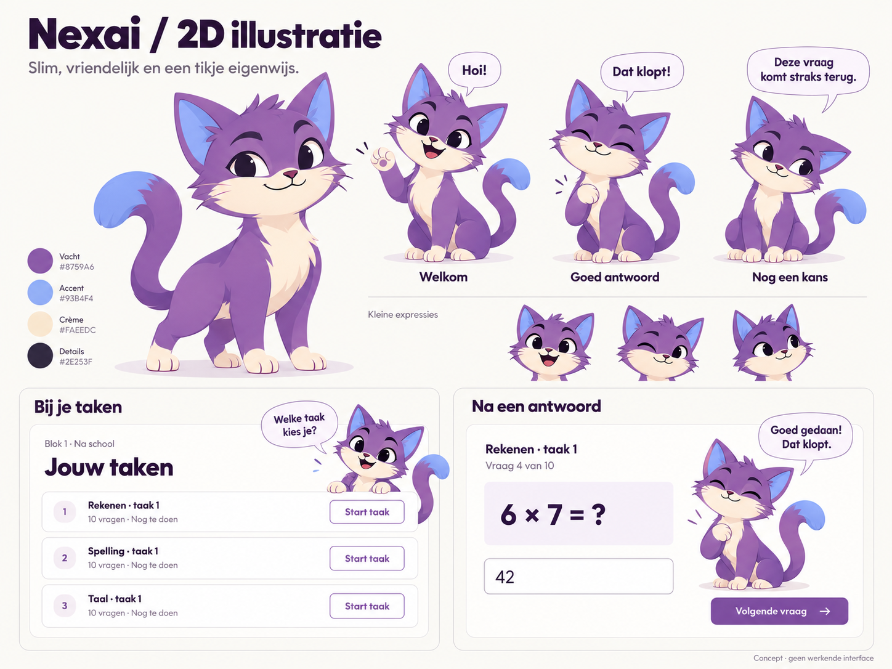
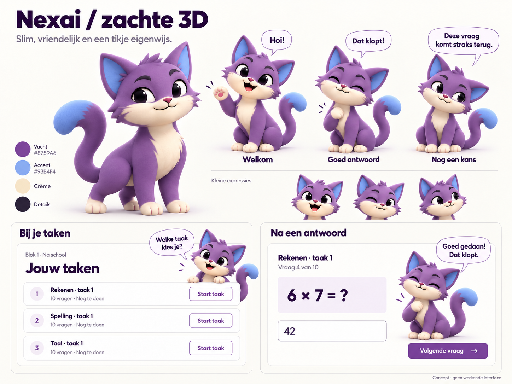

# Nexai — character direction and delivery plan

18 October 2026. **Master v1 and the existing layered greeting Approved.** The user explicitly approved this Nexai and requested a canonical master, character bible and reference sheet. [Read the character bible](nexai-character-bible.md) and [open the reference sheet](references/nexai/master-v1/reference-sheet.svg). The approved layered master now takes precedence over the original concept for future identity matching. New poses and production integration still need their own review.

## Character and scope

Nexai is a clever little cat companion exclusively for Adam's portal: cute, attentive and occasionally cheeky. The guardian portal stays professional and mascot-free. Predefined Dutch messages respond to explicit application events; no chat interface, live AI, effort inference or grading belongs to Nexai.

Use purple/cornflower and existing neutrals. Distinctive curled tail, expressive ears and eyebrows, compact proportions, readable face, no excessive accessories, baby-like proportions or imitation of existing mascots. Warm encouragement after mistakes; jokes only in welcome/celebration moments. Never suggest that Nexai knows Adam's feelings, is disappointed, or is evaluating his seriousness.

Current voice direction: [the character bible](nexai-character-bible.md#personality-and-language) now specifies the user's 19 October request for curious cartoon-cat companionship. [Catalogue 2](nexai-messages.md) supplies 240 researched short messages, now explicitly Approved. Its voice rules supersede the initial copy examples below for future authoring; the current Rekenen revision 4 integrates those approved messages for combined page review. Artwork and timing are unaffected.

## Compare the concepts

### 2D illustration

SHA-256: `a6c32e7de4bc321de2aa51efdb1e03bc32e8d44a5f068a5714b217b93d70b0dc`.

### Soft 3D

SHA-256: `148dc77c19395e936e23b7e4a2b13cde6481f80f664c58d913eafeeef8041bda`.

Each board shows a full-body neutral pose, welcome/correct/encouraging expressions, small face previews, task-page placement and a synthetic exercise screen. The second board references the first to preserve identity. Both use the supplied task-page screenshot as visual context. [Exact prompts, tool and references](references/nexai/prompts.md) are retained for reproducibility.

These are **raster concept images**, not SVG artwork, a Blender model, animation assets or working UI. Their baked-in text is only for concept review; shipped bubbles must be HTML. Any generated shading, cream swatch, icon, typography or layout variation is illustrative, not a token amendment or approval of the task-page redesign. The current source-based palette remains authoritative. The mockups explore placement without committing the product to their incidental layout changes.

## Current production workflow

1. Preserve option 2 as the character reference. Use built-in image generation to prepare transparent raster puppet artwork with matching lighting, proportions and materials. These are derived illustrations, not guaranteed pixel-identical extractions.
2. Compose the body, separate waving arm and closed-eye overlay with SVG clipping/masking. Move the arm about its shoulder and briefly reveal the eyelids. Preserve source PNGs, layer coordinates and timing code. No Blender, WebGL or Three.js is needed for Nexai.
3. Preserve the approved 2.6-second greeting and master v1 before producing the eight-pose catalogue or a shared `NexaiCompanion`. The greeting duration does not change the 600–900 ms per-answer contract below.
4. Future integration remains a synthetic Storybook milestone; real exercise events, backend behavior and broader task-list redesign are outside this delivery.

This supersedes both the original vector-only recommendation and the subsequent Blender proof. The separate gamepas plan is unaffected; the deletion request applies to Nexai's saved 3D work.

## Message and motion contract

Animate after **every submitted answer**, per explicit user choice. Each reaction plays once for approximately 600–900 ms, never delays the next action, and stops when Adam advances. **18 October amendment:** varied ambient animation is now explicitly requested, superseding the prior no-idle restriction. Short clips alternate with rests; users can pause and reduced-motion users receive static poses with identical text. No sound.

| Situation                | Pose             | Initial Dutch copy                           |
| ------------------------ | ---------------- | -------------------------------------------- |
| Task overview            | Welcome          | Welke taak kies je?                          |
| First-attempt correct    | Pleased          | Goed gedaan! Dat klopt.                      |
| First-attempt incorrect  | Encouraging      | Nog niet goed. Deze vraag komt straks terug. |
| Second-attempt correct   | Celebration      | Ja, nu klopt het!                            |
| Second-attempt incorrect | Explaining       | Nog niet goed. Bekijk de uitleg hieronder.   |
| Task completed           | Celebration      | Taak klaar! Goed gedaan.                     |
| Guardian review required | Waiting together | Klaar! Vraag Ammar om samen te kijken.       |
| Gamepas earned           | Celebration      | Je gamepas is verdiend!                      |
| Technical blocker        | Reassuring       | Er gaat iets mis. Vraag Ammar om hulp.       |

At stage 2 create three short reviewed messages for each recurring answer outcome, chosen in a predictable rotation. They must retain the same factual meaning. Source copy is Dutch and always says taak/taken. Final copy catalogue and assets are still pending.

The first mistake reveals no solution and queues the exact question for later; a second-attempt correct answer gives confirmation without explanation. After the second mistake, the planned educational explanation remains a separate capability. Nexai's generic message does not replace it. Display “hieronder” only when the explanation is actually present. No inferred effort, grading, reward entitlement or learning progress may be invented by presentation components.

## Planned presentation interface

`NexaiCompanion` receives a semantic situation, a reviewed message variant and compact/feature sizing. Feature modules own learning state and determine when a reaction occurs; the shared component owns only rendering. Implementation must distinguish a new answer event from an unrelated rerender so a reaction is not replayed accidentally.

- Bubbles are selectable HTML above his head, with Lexend and semantic tokens.
- One Nexai at a time, within document layout: welcome near the task heading, compact next to exercise feedback, larger at completion.
- Never obstruct questions, passages, answer fields, navigation or buttons.
- Decorative artwork is hidden from screen readers. Announce result text once without moving focus; no duplicate announcement between mascot and exercise feedback.
- Missing artwork leaves readable text and working controls. Advancing cancels an old reaction; obsolete messages cannot replace newer feedback.

## Verification and review gates

Stage 1 evidence: both generated boards were visually inspected for consistent identity, complete body/tail, the three requested reactions, Dutch text, small-expression previews and both contextual mockups. Files and hashes were verified. Miniature concepts are not proof of real-device readability or animation performance. Docs/link/format verification is recorded in the delivery entry below.

Stage 2: verify editable source opens correctly, expressions remain recognizable at compact and feature sizes, export dimensions/transparency are correct, and all eight poses preserve anatomy/materials/colors. Review the actual animation samples with the user.

Stage 3: Storybook stories cover all situations, rapid consecutive answers, immediate advance, repeated rerender, long text, missing assets, reduced motion and mobile/tablet/desktop compositions. Run appropriate lint/typecheck/story interaction/axe/build checks and inspect at 320–1440 px. Check keyboard focus, text contrast and announcements. Confirm no answer leakage on first mistakes. Test smoothness on Adam's Tab S9 Ultra before claiming physical-device readiness.

Only the user approves a selected revision. Keep concepts, editable assets, implemented components, executed checks and approval statuses distinct. Stage 1 supplied no source component, animation runtime, editable master or physical-device test. The subsequent Blender proof was discarded at user direction; the current layered proof is recorded below.

## Research basis

- [Adobe: saving artwork and SVG](https://helpx.adobe.com/illustrator/using/saving-artwork.html) — vector delivery is supported; preserve editable source separately from optimized export and account for rasterized effects.
- [Adobe: scripts](https://helpx.adobe.com/illustrator/desktop/automate-visualize-data/automate-actions/install-and-run-scripts.html) — scripting is a possible authoring workflow, subject to local access verification.
- [Blender: output properties](https://docs.blender.org/manual/en/5.0/render/output/properties/output.html) — transparent images and rendered sequences support a 3D appearance without live rendering.
- [Blender: glTF export](https://docs.blender.org/manual/en/5.1/addons/import_export/scene_gltf2.html) — a later live-3D route requires export and material/animation verification; it does not automatically match a Blender render.
- [Three.js: rendering on demand](https://threejs.org/manual/pages/rendering-on-demand.html) and [resource cleanup](https://threejs.org/manual/pages/cleanup.html) — live rendering has device-power and resource-management costs. Pre-rendering is our engineering recommendation for this scope, not a claim that all 3D is unsuitable.
- [W3C: animation from interactions](https://www.w3.org/WAI/WCAG21/Understanding/animation-from-interactions) and [pause/stop/hide](https://www.w3.org/WAI/WCAG21/Understanding/pause-stop-hide.html) — respect motion preferences and avoid distracting persistent motion.

These sources inform the production/accessibility approach. They do not establish that this particular mascot improves Adam's learning; that requires observing real use.

## Stage 1 delivery evidence — 18 October 2026

- Both boards saved as 1448 × 1086 PNGs (requested target dimensions in the prompts were advisory; these are the actual output dimensions).
- Built-in image generation used; no CLI/API-key fallback. Prompts and source reference preserved locally.
- New Markdown files formatted with Prettier. `git diff --check`, local reference existence, PNG signatures/dimensions and approval-row verification passed.
- Practice source fingerprint rechecked: matches the approved revision 3. Application source and dependencies were not changed in this stage.
- Application tests/builds and physical-device checks were not rerun for this documentation/concept-only delivery. Earlier 30-story evidence belongs to the practice-card revision, not to a Nexai runtime.

## 2.5D proof — revision 1, 18 October 2026

[Open the local review](http://127.0.0.1:6010/layered-v1/review.html). The review compares the original option 2 with a layered illustration and short blink/wave. Source files, generation prompts and verification are in [the asset workflow](references/nexai/layered-v1/README.md).

The arm is a separate raster layer, rotated around the shoulder behind the body. A feathered eye mask reveals the matching closed-eye artwork for two short blinks. A subtle whole-body tilt accompanies the wave. Text remains selectable HTML above Nexai. Replay cancels any prior playback; stop resets the pose; the timeline allows inspection. Reduced-motion preference or the static-view toggle keeps the character still. No autoplay, sound or endless idle animation.

**Approved master v1 and greeting (18 October 2026):** this derived artwork is now the identity source of truth, rather than an exact copy of the original concept. The full pose catalogue, shared component, task-page integration and physical-device readiness are not delivered by this proof. No app source, stack, dependencies or guardian screens changed.

### Removed at the user's request

Deleted the authored Blender master and backup, build/render/verification scripts, exported portraits/cutout/movie/poster, old comparison page and all local Blender draft frames/logs/screenshots. Removed the old source-download route and its page-specific design-hook suppression. The original option 2 concept, prior research/decision history and separate planned gamepas are retained.

## Current implementation — motion review v1

The user accepted the overall Rekenen journey and requested full-body Nexai everywhere unless intentionally occluded, shared input reviews followed by an animation review, varied ambient cat behavior and quieter technical copy. The new shared component and twelve-clip review are documented in [Nexai motion](nexai-motion.md); the earlier statements about missing shared integration are historical. Master v1 remains immutable and approved; new motion/placement/yawn artwork is In Review.
