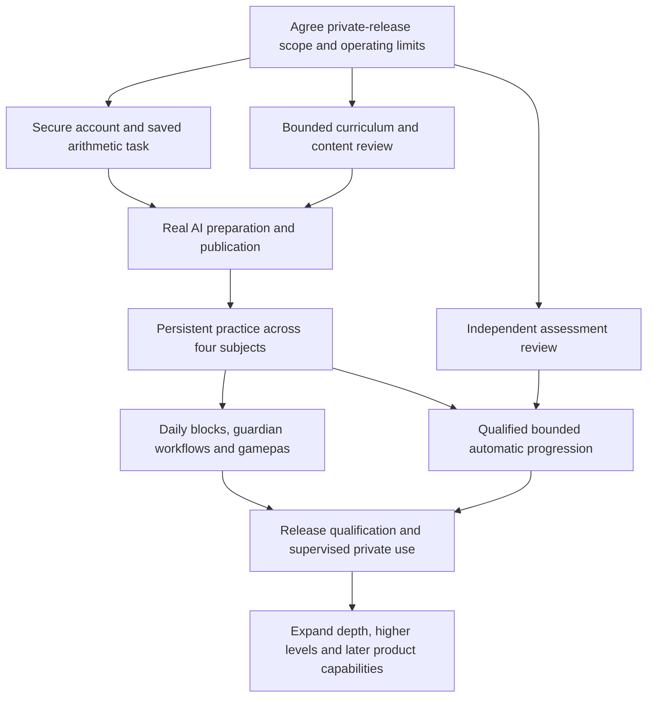

# From prototypes to Adam's daily-use application

**20 October 2026 hosting amendment (user-authorized):** use self-hosted PostgreSQL on `nexo-vps`, replacing the previously selected managed database. Keep the VPS clean and organized: dedicated `/srv/apps/nexo-school`, `/srv/data/nexo-school/current` and `/srv/backups/nexo-school/postgresql`, matching the existing Auctus structure without changing its services or data. This authorizes a dedicated PostgreSQL service and synthetic D02 migration/recovery verification via SSH. It does not authorize a public main-app deployment or real learner data. See the [PostgreSQL runbook](../docs/engineering/vps-postgresql.md). Clean, organized infrastructure is a standing requirement.

20 October 2026 · Delivery plan revision 1 · **Approved by the user on 20 October 2026**

This is the integrated delivery plan requested after work across several threads. It extends the existing [plan](plan.md) and [MVP scope](../docs/product/mvp-scope.md), preserves their history, and replaces their old implementation order as the **approved delivery sequence**. Approval was explicit: “I approved this plan.” Every agent must follow the [mandatory task workflow](../AGENTS.md#approved-delivery-plan-and-mandatory-task-workflow) and inspect [current progress](todo.md#current-position-and-handoff) before starting. Specific user assignments proceed within this plan without asking for plan approval again. This approval does not mark any implementation complete or satisfy provider-spending, remote-migration, deployment, real-learner or educational-validation gates.

**23 October 2026 approved content-supply amendment:** GPT-6 Luna is the provisional default AI generator and Claude Haiku 5.5 the first-pass reviewer; deterministic TypeScript remains preferred. Target 50–200 exercises/day with 15–30 minutes/week ongoing review. Certified families, reviewed constrained banks, independently verified word problems, reusable semantic/reading batches and separate practice/assessment/retention stock govern M2 and later subject/inventory work. The user explicitly assigned and subsequently approved the bounded D13 v2 contract repair, then assigned the first D14 reusable-batch slice; this does not waive D13 independent reference adjudication or D11 educational certification. D14 must support family/batch/bundle review and measure active review time; D15 quarantine/correction remains a release dependency. No additional paid experiments without explicit authorization. [Implementation, estimates and focused next slice](../docs/engineering/scalable-content-supply.md).

**23 October 2026 supply-first assignment (user-authorized):** implement **D14-S1**, one bounded reusable-supply slice for Rekenen / Optellen (the D11 digit-addition subset), before further general review-interface expansion. Reuse exact published eligible bank versions, admit at most eight fresh exercises with correction headroom inside ten new versions per Amsterdam calendar week under a 15-minute estimated review allowance, account for outstanding work and measured review time, and surface shortages. Start with local synthetic planning/reservations only; preserve unapproved family certificates, separate practice/assessment/retention boundaries and D15/D25 integration gates. No new paid provider call or educational approval is authorized. This does not establish full-category or 600-exercise weekly capacity.

**23 October 2026 family-review assignment (user-authorized):** D14-S1 is approved for its delivered local supply/UI scope. Start **D14-S2**, a bounded one-time Optellen family-certification workflow and exact-version review package. Seven boundary examples and four human judgment areas accompany exhaustive technical checks; upfront review time is separate from ongoing supply review. Preserve independent educator review, provisional/guardian findings, source/inventory binding and D15/D25 gates. Approval of S1 does not certify the arithmetic family.

**23 October four-phase implementation amendment (user-authorized):** deliver D14-S3a/S3b and the first D16 family together, then a separately tested server-recorded attempt shadow adapter within D30 preparation (daily integration remains D25). Bounded two-digit operands 10–99 with sums ≤100 are explicitly assigned. Reuse existing review, exercise, submission and assessment modules. This does not activate skipping/mastery, bypass D15/D24/D25/D29–D31, authorize remote changes or paid AI, or confer educational certification.

**24 October 2026 autonomous-delivery amendment (user-authorized):** the reusable addition families and Phase D shadow preparation are accepted as a **tested technical milestone**, not approval of new educational content or mastery decisions. Preserve addition and its tests; further polishing requires a defect or necessary integration reason. Deliver **D21-P1**, one bounded Spelling proof through the existing shared lifecycle now. Expand related categories in substantial independently testable batches; routine generators, variants and fixes do not need repeated guardian permission. Broader category and daily-assignment work in this assignment is sequencing, not activation. No paid calls, remote deployment, publication bypass or automatic progression is authorized. The execution sequence in §6 and §11 supersedes older one-family-per-chat and foundation-era next-step wording without removing task acceptance criteria.

**24 October saved-application amendment (user-authorized):** D21-P1 is accepted as a tested technical milestone. Execute D14-S4 shared eligible-content assignment integration and D15 withdrawal/correction now, with an authenticated disposable-local PostgreSQL journey. Next prove a small saved rehearsal across the four subjects including daily Redactiesommen, then D24/D25 scheduling, substantial curriculum batches and remaining release gates. This supersedes the earlier suggestion to implement D24 before the representative saved formats. D15's dependency for this bounded milestone is the completed S4 eligibility boundary plus D06; full D14 educational certification/general supply remains separately open. No new content approval, production mastery, paid call, deployment or real learner data is authorized.

**25 October portal-access amendment (user-authorized):** implement D04-M1 now, completing ordinary guardian/student access over D02–D04/D07/D08 before D14-S5. The user must be able to sign in from normal browsers and test saved work with retained local synthetic accounts/data, without temporary test sessions. Reuse the approved designs and existing auth mechanisms; retain independent roles, MFA/browser grants and recovery boundaries. Next: D14-S5 → D24/D25. This authorizes local implementation and persistent synthetic setup, not public deployment, VPS changes, production email, real learner use or new educational approval.

**25 October D04-M1 implementation handoff:** local portal access and retained test setup are implemented/tested; new UI is In Review. The user can sign in normally and rehearse the saved workflow using the [portal runbook](../docs/engineering/local-portal-access.md). Exact checks and remaining environment/device gates are in the [ledger](todo.md#current-position-and-handoff). D14-S5 is next, followed by D24/D25; full category/content/release acceptance is unchanged.

**26 October D04-M3 user amendment:** normalize completed practice results to 10 independently of task length, preserving weighted points and assessment rules; make ordinary content review notes optional while retaining explicit review/publication. The current guardian workspace is for testing and is not the definitive approved portal design. Maintenance does not advance D14-S5 or D24/D25. [Contract](../docs/design/guided-local-workflow.md).

**26 October D04-M2 usability amendment (user-authorized):** simplify the current local workflow now, preserving its functionality. Make the next action explicit across guardian setup, content preparation/review/publication, assignment and results; improve empty states and returning navigation. Reuse existing APIs and controls. This is presentation maintenance before D14-S5, with new guidance In Review; no curriculum, scheduler, authentication-policy or educational-approval change. [Contract](../docs/design/guided-local-workflow.md).

**27 October D04-R2 design assignment (user-authorized):** start the bounded guardian journey/reference-design pass now. The user requires clear outcomes, honest undo or pre-confirmation consequences, and an obvious next step, while keeping all capabilities and backend complexity behind intuitive presentation. Build/review a synthetic desktop/phone prototype using approved foundations; preserve the working saved portal and retained accounts/data. [Current design contract](../docs/design/guardian-portal-r2.md). This assigns the earlier recommendation; it does not activate D24/D25/D26, approve new screens or change the functional sequence D14-S5 → D24/D25.

**28 October D04-R3 approval:** the user approved the new Guardian visual language and required it for every future Guardian/admin page and feature. Guardian learning activities use sessie/sessies; student wording and internal task/assignment identities stay unchanged. This is visual-system approval, not completion of preview-only automation or educational validation.

**28 October D04-R3 visual-system amendment (user-authorized):** replace the rejected D04-R2 frontend using the supplied sketch renders, establish Guardian-only shared design rules and permanent subject icons, and redesign the Guardian portal while preserving working functions. Research dependencies before adding them. Scope includes routine local frontend integration and necessary supporting functionality; existing environment, educational and content-publication gates remain. [Visual contract](../docs/design/guardian-visual-language.md). Student design remains separate; functional sequence D14-S5 → D24/D25 is unchanged.

**29 October D14-S5 implementation handoff:** the user-assigned local saved multi-subject rehearsal is implemented/tested across all four subjects including Redactiesommen. Reuse the approved Guardian language, retained accounts and shared content lifecycle. [Scope and manual rehearsal](../docs/engineering/saved-multisubject-rehearsal.md); [executed evidence and remaining gates](todo.md#current-position-and-handoff). The next functional sequence is now **D24 → D25**. This closes only the bounded synthetic rehearsal, not full content coverage, educational qualification, automatic progression or release authorization.

## 1. The finish line

**23 October 2026 reuse/teaching amendment (user-authorized):** the single-digit addition format and bounded procedural-practice scope are approved; teaching explanations need revision. Keep generation, validation, certification, review and publication shared across subjects, with subject-specific extensions. Inspect/reuse existing larger-addition logic and presentations before D16's next family. D14-S3a/S3b are proposed bounded follow-ups, with assessment preparation reusing the current policy and actual daily integration remaining D25. Preserve D15 and educational-validation gates; approval for practice does not authorize mastery/category skipping. [Inspected reuse map and next slices](d14-addition-reuse-handoff.md). This update records the user's direction and requested pre-implementation explanation; it does not claim those extensions are implemented.

**Confirmed in this planning interview:** the first release is a private daily-use application for Adam and Ammar, covering all four subjects. Ammar will skim the actual exercises, inspect automated-review findings and correct mistakes within a target of **15–30 minutes per week**. **All categories in his supplied catalogue and a working, polished Blender/Three.js gamepas are required before launch.** Open-ended writing/speaking receives AI feedback and guardian review. The entire AI planning budget is **at most €10/month, preferably lower**, not permission to spend. Normal progression should happen automatically within limits he chooses, with notifications for problems or changes outside them.

The four product subjects are **Rekenen, Taal, Spelling and Begrijpend Lezen**. **Redactiesommen is a category within Rekenen**, with daily practice. Five existing exercise presentations do not imply five peer subjects.

The intended daily experience:

1. Adam independently signs in on his approved tablet.
2. He sees today's ordered blocks, with category-labelled tasks. He chooses the task order inside the available block.
3. Questions are ready when he starts. His work survives refresh, browser closure, an interrupted connection and server restart.
4. Approved question, feedback, deferred retry, score and Nexai behavior remain recognizable.
5. Finishing work updates the guardian's actual results and, where enabled, earns a gamepas.
6. The system prepares subsequent work within the guardian's limits, preserving exact unfinished questions and checking previously learned material when appropriate.
7. Ammar can check attention items, understand progress, adjust limits and review a small organized content queue from MacBook or iPhone.
8. AI outages or spending limits stop new generation, not already prepared practice or answer storage.

“Ready for Adam” requires functioning content, accounts, saved progress, recovery and operational safeguards. It is not a publicly accessible Storybook with the preview labels removed.

## 2. What the repository contained at the D00 audit

This table is the pre-D02 snapshot. D02 subsequently implemented the local identity schema and migration; the current ledger owns implementation status.

Audit evidence is split into the [learning/domain audit](../docs/research/2026-10-20-learning-readiness-audit.md), [runtime audit](../docs/research/2026-10-20-runtime-readiness-audit.md), [UI audit](../docs/research/2026-10-20-ui-readiness-audit.md) and [content-delivery research](../docs/research/2026-10-20-content-delivery-strategy.md). These are source inspections, not educational certification or a live infrastructure audit.

| Area                   | Actual implementation                                                                                                             | What it does not establish                                                                 |
| ---------------------- | --------------------------------------------------------------------------------------------------------------------------------- | ------------------------------------------------------------------------------------------ |
| Approved stack         | Next.js/React/TypeScript, npm/Node 24, Prisma PostgreSQL adapter preparation, quality scripts and CI definitions                  | A working production learning service                                                      |
| Application entry      | `src/app/page.tsx` renders `FoundationNotice`                                                                                     | Student, guardian or admin application routes                                              |
| Persistence            | Prisma generator/datasource and lazy server-only connection adapter                                                               | Any auth, curriculum, content, assignment or attempt table; there are no domain migrations |
| Authentication         | Separate SQLite-based feasibility spike, accepted core tablet/guardian flow                                                       | Production PostgreSQL auth, final-origin enrollment, application authorization             |
| UI/design              | Approved shared components, guardian shell, Nexai library/copy, five exercise presentations and connected synthetic journey       | Complete guardian planning/admin workflows or server integration                           |
| Exercise behavior      | Pure temporary answer/retry state, subject specimen scoring, solved and weighted result projections                               | Server authority, durable resume, transactional deduplication or protected answer keys     |
| Automatic path         | Two bounded Rekenen categories; Taal recognition/practice and deliberate missing-content blocking; daily synthetic Redactiesommen | Full categories, all-subject automatic routes or real ability assessment                   |
| Shared assessment      | Versioned deterministic evidence policy and adverse-case tests                                                                    | Calibrated confidence, reliable inference of intent, or validated category skipping        |
| Validation preparation | 27 draft Getalbegrip items, blueprint, frozen synthetic experiment and educator package                                           | Educator-approved items, replenishable assessment stock or empirical validation            |
| AI content             | Detailed architecture and publication policies                                                                                    | Provider adapter, jobs, actual generation, review/publishing or budget enforcement         |
| Gamepas                | Design placeholders and documented requirements                                                                                   | Earning, activation, durable timer, expiry or 3D asset                                     |
| Operations             | Foundation Docker/standalone build and separate spike deployment materials                                                        | Main-app deployment, live backups, restore, capacity evidence or release qualification     |

Fresh checks in this audit: **110 unit tests passed across 22 files; strict typecheck passed** using Node 24.22.0. No remote database, live AI or deployed spike was used. Historical story/E2E outcomes remain dated evidence in their contracts, not freshly rerun claims.

The UI investment is reusable. The largest engineering gap is the persistent, authorized application behind it. The largest content gap is reviewed curriculum/item coverage. These need coordinated delivery rather than more disconnected demos.

## 3. Decisions and conflicts

| Topic                               | Current direction                                                                                                                                                                                                                               |
| ----------------------------------- | ----------------------------------------------------------------------------------------------------------------------------------------------------------------------------------------------------------------------------------------------- |
| Automatic versus manual advancement | This interview confirms automatic progression **within guardian-selected limits**. It supersedes the earlier approval-for-every-change preference. It does not approve current synthetic thresholds.                                            |
| AI for every question               | The latest conversational wording conflicts with the explicit deterministic-first decision in ADR-007. Recommendation: retain code for certified arithmetic and AI for semantic content. No generation policy is silently changed by this plan. |
| Manual content review               | Ammar accepts reviewing batches, provided the workflow is economical. Review capacity must be measured. Approval cannot be inferred from an unopened batch.                                                                                     |
| Assessment work                     | Keep revision 3 and the bounded validation tooling In Review. Continue useful delivery work while educational review proceeds. Do not build another assessment engine or keep tuning synthetic thresholds without new evidence.                 |
| Curriculum                          | Use publisher-independent Dutch groep-5-plus objectives. Exact textbook editions are not a first-release dependency; do not claim exact alignment with Adam's classroom.                                                                        |
| Old roadmap                         | Earlier 85% mastery proposals, manual-only planner, five-peer taxonomy, optional Storybook and pnpm wording are historical where later decisions supersede them. Current policy, npm scripts and approval register govern.                      |
| Personalized explanations           | Requested and retained. Safe live output/data handling is unresolved; existing fixed explanations do not fulfill that whole requirement. See section 8.                                                                                         |
| First-release breadth               | All supplied categories across all four subjects, including writing and speaking/listening, are required before launch. Small content batches below are development increments, not a reduced launch.                                           |
| Gamepas                             | Earning, activation, durable timer **and polished Blender/Three.js design** are launch requirements. This supersedes the proposed presentation deferral.                                                                                        |
| Budget                              | At most €10/month for all AI operations, preferably lower; benchmark low-cost models and enforce reservations/usage across features.                                                                                                            |
| Open-ended judgment                 | AI feedback with Ammar's review, including writing and speaking; pending judgments must have an explicit completion/reward/evidence contract.                                                                                                   |
| Automated review                    | Research/design a review assistant and cost model. Ammar sees actual exercises and can correct them; automatic semantic publication is not newly authorized.                                                                                    |

## 4. Three coordinated workstreams

**Application delivery:** real routes, accounts, saved tasks, guardian results, daily plans and operations.

**Content operations:** bounded curriculum releases, deterministic families, semantic generation, quick review, publication and supply.

**Assessment validation:** educator review, adequate independent item families, shadow evaluation and approved decision-use boundaries.

Application and content work can progress while assessment validation is pending. Real automatic knowledge-based skipping cannot. If validation is not ready at release, present a deliberate choice: wait for it, or explicitly approve a supervised practice release without automatic skipping. Do not quietly ship an unvalidated engine or quietly remove the requested automation.

Each milestone below delivers an end-to-end behavior. The backlog breaks it into focused tasks; neither a whole database-first phase nor a whole UI-first phase is proposed.

## 5. Milestones and acceptance gates

### M0 — One agreed delivery contract

Deliver a signed-off first-release envelope: all-category coverage and answer formats, workload/block limits, automatic progression boundaries, review capacity, AI caps, explanation behavior and operational owner. Preserve existing approved visual contracts. Record which remaining screens actually require review.

Audit the current uncommitted/untracked work before creating a clean baseline; include approved artwork and source manifests intentionally. Do not delete or overwrite other agents' work, or mass-commit secrets/generated artifacts. Resolve the known formatting-policy problem deliberately rather than claiming the aggregate check is green.

**Exit:** one current roadmap/backlog, explicit release scope and no ambiguity about which assessment/content revisions are still Draft/In Review.

### M1 — Secure sign-in and one saved task

Build the first production-shaped vertical slice using synthetic identities and a disposable local PostgreSQL database first:

- Real student/guardian route composition with the approved shells; no demo role switch in the product.
- Better Auth/Prisma integration with guardian MFA, supervision, approved-browser enrollment, independent student passkey sign-in and revoke/recover.
- One certified arithmetic family, a pinned assignment and server-authoritative submissions.
- Exact deferred retries, both committed attempts, weighted/solved results and guardian result detail.
- Resume after refresh, closed browser and restart; duplicate/conflicting requests do not consume attempts or change scores.

Keep public question presentation separate from answer keys/evaluation specifications. Reuse the visual exercise composition, but replace its preview-only `ExerciseDefinition` scoring/key access with a server-backed presentation contract. Preserve deterministic rules and their tests; do not copy browser grading into a trusted endpoint.

**Exit demonstration:** synthetic guardian enrolls a student; student submits, closes and resumes a task; guardian sees the same saved facts; another family's identity cannot read or mutate them. Built standalone output serves selected Nexai/font assets. No live child data yet.

### M2 — A real content supply loop

Introduce AI early, not after all other subjects:

- Minimal versioned curriculum/content records for the selected slice, immutable publication and exact-hash approval.
- Certified deterministic arithmetic generation with independent verification and zero provider usage.
- One external provider adapter and durable PostgreSQL jobs executed in bounded bursts from the same application image.
- Small semantic generation batch, deterministic checks, separate AI review with cited concerns, actual guardian review and publication. Benchmark the reviewer against adjudicated defects before relying on its flags; show every exercise, not just a summary.
- Budget reservation, usage reconciliation, retries, lease recovery, rejection, quarantine and correction provenance.

A fake provider supports normal tests. A separately authorized, capped real-provider evaluation must demonstrate actual usable content; a mock-only pipeline does not satisfy MVP AI.

**Exit demonstration:** generate → validate → review → publish → assign → complete → report, then disable the provider and complete another already-published task. Editing reviewed content invalidates approval. Wrong keys can be withdrawn and their affected results identified.

### M3 — Persistent learning in all four subjects

Reuse each approved presentation and add content-specific contracts:

| Subject/presentation     | Required production work                                                                                                                                            | Gate                                                                                                             |
| ------------------------ | ------------------------------------------------------------------------------------------------------------------------------------------------------------------- | ---------------------------------------------------------------------------------------------------------------- |
| Rekenen                  | Certified families for selected ranges; exact response policies; decimal/fraction/unit support, clock/geometry/graph representations for required launch categories | Independent solver/gold cases; Dutch input forms; malformed input is not an attempt                              |
| Rekenen → Redactiesommen | Reviewed continuous passage and final answer; daily selection tied to suitable maths objectives                                                                     | Story/key consistency; no reading/mastery credit invented from a final number                                    |
| Taal                     | Reviewed finite answers/choices and accepted variants; writing rubrics and speaking/listening capture/playback/review                                               | Finite answers use deterministic grading; open-ended scoring/guardian review needs an explicit approved contract |
| Spelling                 | Objective-specific case/accent/spacing policy; errors preserved; enough reviewed patterns                                                                           | Gold cases preserve meaningful misspellings and reject improper normalization                                    |
| Begrijpend Lezen         | Immutable passage/question bundles, anchors, rationale and reveal dependencies                                                                                      | Passage/version integrity; feedback cannot silently contaminate later assessment evidence                        |

The production roadmap's multi-blank and operation/calculation/unit tasks remain required launch capabilities. Writing and speaking/listening are also now required; they cannot be deferred under the earlier optional-speech wording. Their richer UI needs its own bounded design review when introduced; the current single-answer screen is not proof they exist.

**Exit demonstration:** every launch category and its listed objective groups have suitable published content and formats, an assigned task, durable two-attempt history, correct feedback, resume and guardian detail. Unsupported categories are not assignable or marked mastered.

### M4 — A sustainable daily routine

Make daily assignment an idempotent server use case with an Amsterdam-local date and a catch-up path if a scheduled run was missed.

- Guardian sets weekday workload, block ordering, subject/category bounds and game minutes once; dated exceptions are separate from standing settings.
- Daily Redactiesommen remains explicit, including weekends unless the user later changes that requirement.
- Select from approved stock. Preserve exact unfinished work and use compatible future capacity before creating new work; never substitute a Redactiesommen task into an Optellen-only slot.
- Preserve started assignments when settings, content availability or level estimates change. Handle removed categories and old work through visible guardian choices.
- Bound retention/support tasks inside workload rather than adding invisible extra work.
- Today is the student's entry. Guardian sees actual week totals, carryover, shortages and upcoming capacity.

**Exit demonstration:** a synthetic multi-day/weekend/DST scenario with missed days, schedule exceptions, partial tasks, changed limits and duplicate issuance preserves every answer and the intended capacity. No endless backlog accumulation or automatic replacement of started work.

### M5 — Guardian attention, review and rewards

Complete the compact dashboard using real facts: current blockers, finished work waiting for review, relevant answer examples, content shortages and qualified learning recommendations. Reuse approved colors and navigation.

Review decisions remain **accept** or **repeat**. A repeat preserves the original result and creates fresh equivalent work at the same difficulty; a reading repeat preserves its paired text/questions and records prior exposure. Technical completion, review acceptance and reward eligibility are separate states.

Implement gamepas rules as server state: once earned, one activation, authoritative start/end, expiry, refresh/device consistency and an accessible timer. The pass communicates the agreement; it does not control a console or lock other apps. Design and obtain approval for the polished Blender/Three.js pass **before launch**, with editable source, optimized exports and earned/ready/active/used/expired states. Integrate it with the real entitlement and timer. Supply reduced-motion/static/WebGL-failure fallbacks; reward correctness must not depend on rendering. This is a required deliverable, not optional polish.

**Exit demonstration:** complete a block → earn one pass → activate → refresh → remaining time is correct; replay cannot mint another pass. The approved 3D pass is smooth and usable on the actual tablet and phone; a flagged task waits for the guardian's recorded decision. Do not automatically accuse Adam of rushing or laziness based only on speed/errors.

### M6 — Validated, bounded automatic learning paths

Use the existing evaluator boundary and research. Establish one reviewed vertical curriculum path at a time, then use the same release protocol for the other subjects.

1. Independently review objective boundaries, prerequisite edges, item families, response rubrics and initial levels.
2. Repair the existing bounded package's disclosed content weaknesses; produce sufficient fresh practice, confirmation and delayed-check inventory.
3. Preserve versioned policy and histories. Run the mandatory adverse-case, scoring and regression gates.
4. Under separately authorized data handling, evaluate shadow recommendations against independent judgments and fresh delayed outcomes. Define acceptable risk and burden before observing results.
5. Enable decision use only for the reviewed scope with explicit approval. Missing content or evidence stays visible; no unsupported skipping.
6. Extend to Taal, Spelling and reading with their own valid evidence strategy. A generic `subject` union does not validate every subject.

Guardian limits govern what the engine may assign and how far it can advance. Ordinary authorized progression is automatic; exceptions, persistent difficulties, content blocks and changes outside limits create attention items. Guardian holds change permission, never evidence.

**Exit:** the first-release scope has approved educational decision-use boundaries and suitable inventories. No “highly accurate” claim based on synthetic pass counts. Correct answer scoring, policy correctness and educational validity are reported separately.

### M7 — Explanations that actually help

Keep trusted, reviewed explanations available for every published item. Extend with reviewed misconception-specific branches where an actual answer supports that interpretation, in simple Dutch.

The requested answer-personalized AI explanation needs an explicit release design: what leaves the server, trusted key/context, allowable output, validation, latency limit, budget, safe fallback, and reading answer-leakage treatment. A model must not change the grade or invent certainty about Adam's thinking. Display no explanation after a correct second attempt; first misses reveal no solution.

**Exit:** second-miss feedback is helpful and correct under normal, slow, unavailable and malformed-provider cases. Any live personalized path has passed its own reviewed evaluation; otherwise only an explicitly accepted bounded alternative ships. This milestone is not open-ended tutoring or a chat interface.

### M8 — Qualify and launch the private application

Build off-host and deploy an immutable image to the existing Docker/Caddy setup after explicit authorization. Use a stable HTTPS origin and final-origin passkey enrollment. The accepted auth spike is evidence to reuse, not a reason to repeat its whole feasibility project.

Before real daily use:

- Private APIs, SSR, exports and background reads enforce the same ownership checks.
- Production HTML/bundles/network responses contain no unrevealed keys or secrets.
- Backup restoration, revocation/deletion after restore, image rollback and migration compatibility have been demonstrated using synthetic data.
- Shared-VPS load runs alongside representative other workloads, generation and backup; measure memory, swap, CPU and warm/cold latency.
- Privacy/data-flow, processor, retention, export/delete and operator decisions are concrete for this family release. Institutional expansion has a separate review.
- Test actual Tab S9 Ultra Chrome, MacBook and iPhone critical paths, including software keyboard, interrupted network and long reading. Earlier skipped Safari spike checks remain honestly skipped; supported release-browser claims need release evidence.
- Stock, review time, spending and support capacity meet the agreed operating envelope.

**Exit:** approved go/no-go checklist and a supervised first-use period with a documented stop/recovery route. A proposed seven-day operational observation window can exercise weekday/weekend flows; it is not educational validation or an arbitrary legal requirement.

### M9 — Expand beyond the complete private-release catalogue

All supplied categories, required richer formats, polished gamepas and accepted personalized-help behavior belong before private launch. After launch, expand depth, difficulty and additional objectives in reviewed releases rather than build a new UI per category. Retain advanced groep-5-plus material, School/Growth selection, lesson depth and progress history in the broader vision; do not relabel missing launch categories as post-launch expansion.

Later independent milestones include validated attention-pattern detection, narrow automated semantic publication, additional guardians, English showcase, personal-assistant integration and broader families/schools. None should be smuggled into the private-release critical path. Public/institutional launch requires its own authorization, access model, privacy/contract and measured capacity gates.

## 6. Curriculum coverage without another open-ended research project

Use the [user-supplied catalogue](../docs/research/references/2026-10-19-user-category-list.txt) as product organization, with the accepted separate **Verbanden, tabellen en grafieken** entry. Keep canonical objectives independent from menu headings and practice formats.

The full [launch coverage checklist](../docs/product/private-release-coverage.md) maps every supplied heading to required formats and evidence. The catalogue has 12 Rekenen, 7 Taal, 5 Spelling and 10 reading headings. These are product groupings, not 34 equally sized skills. Preserve separate internal Meten, Meetkunde and Verbanden objectives even if the menu groups them; spelling application is a format axis rather than a new independent spelling rule.

Deliver in batches to control review and integration size, but **finish every required row before launch**. Begin with whole-number/finite-answer families, then fractions/decimals/diagrams/audio, then open-response writing/speech and reading rubrics. A category is complete only when its listed objective groups have published content, suitable representations, response/scoring contracts, explanation support, usable stock and reviewed assessment boundaries. Ten generic questions or a screen title do not meet that criterion.

The initial level is groep 5 with prerequisite review and upward progression within approved limits. Formal percentage calculation and complicated fraction arithmetic are not default groep-5 requirements. A higher level remains an explicitly reviewed extension; no unsupported automatic jump.

### 24 October inventory and autonomous batch sequence

Fresh inspection of `src/modules/curriculum/required-coverage.json`: **210 required entries / 34 headings** (Rekenen 90/12, Taal 43/7, Spelling 34/5, reading 43/10). The rows are requirements, not certificates. Existing code has approved exercise presentations for all five formats, temporary connected practice, local authenticated saved arithmetic and guardian results, shared content records/review/publication, bounded addition families and now D21-P1. It does **not** have published production coverage for those 210 entries. D05 assignment still calls its fixed `seedItems()`; D10 content publications are not yet its input. Taal/Spelling/reading/Redactiesommen previews do not supply durable assignment adapters.

Use the following ordered batches inside the existing task IDs. Each batch includes generators/banks, gold cases, review packages, server evaluation/presentation where needed, source provenance and per-objective coverage evidence. It may span several commits or implementation sessions; verify independent slices rather than waiting for an enormous final test run. A completed batch does not silently mark a whole category complete.

| Batch / tasks                                    | Complete coverage allocation                                                                                                                                                                                                                                                        | Practical shared work and publication boundary                                                                                                                                                                                                                                                                                                                   |
| ------------------------------------------------ | ----------------------------------------------------------------------------------------------------------------------------------------------------------------------------------------------------------------------------------------------------------------------------------- | ---------------------------------------------------------------------------------------------------------------------------------------------------------------------------------------------------------------------------------------------------------------------------------------------------------------------------------------------------------------- |
| A — D16 whole numbers                            | Getalbegrip, Optellen remaining objectives, Aftrekken, Vermenigvuldigen, Delen, Hoofdrekenen (38 entries)                                                                                                                                                                           | Reuse arithmetic generators/oracles, exact integer responses, missing-value and method formats. Group subtraction/inverse addition, multiplication/division and number/mental strategies. Preserve delivered addition; add only missing coverage. Each range/method keeps its own independent checks and review binding.                                         |
| B — D21 word/rule banks                          | Klankwoorden (7), Regelwoorden (9), Weetwoorden (7)                                                                                                                                                                                                                                 | Extend the proven closed-bank adapter with sourced forms and rule-specific constraints. Batch related vowel/consonant patterns and inflections. Do not turn a regex into a Dutch dictionary. Reviewed banks, not thousands of individual word variations; new exceptions or explanatory rules require package review.                                            |
| C — D20 language + D21 sentence application      | Taal Woordenschat (7), Woordsoorten (6), Zinsbouw en zinsontleding (6), Werkwoorden (5), Woordvorming (5); Spelling Hoofdletters en leestekens (6), Spelling toepassen (5)                                                                                                          | Share reviewed vocabulary/inflection banks where relevant, but keep objective-specific grading. Sentence meaning, ambiguity, punctuation and distractors require semantic review. Spelling toepassen is a format axis, not extra independent mastery evidence. Dictation/audio remains a separately verified D21 slice with leakage and tablet-keyboard checks.  |
| D — D17/D18 exact quantities and representations | Breuken (7), Kommagetallen (4), Geld (6), Tijd en klokkijken (7), Meten en meetkunde (10, retaining separate Meten/Meetkunde/Verbanden-tabellen-grafieken objectives)                                                                                                               | Exact fractions/scaled integers and Dutch units first; then shared accessible clocks, diagrams, money, tables and graphs. D16 prerequisite contracts precede integration; content work can be prepared without marking dependencies complete. New representations receive focused visual/accessibility review.                                                   |
| E — D19 daily applications                       | All 18 Redactiesommen entries, continuously alongside A/D                                                                                                                                                                                                                           | Start a bounded reviewed bank using already supported operations for the daily milestone; extend with each verified operation/unit batch. Full D19 still depends on D16–D18. Keep one continuous passage, operation/calculation/unit reasoning, independently verified keys and semantic/passage review. Never invent a fresh story merely to fill today's slot. |
| F — D22 reading bundles                          | Onderwerp en hoofdgedachte (3), Informatie vinden (3), Hoofd- en bijzaken (3), Tekstsoorten en tekstdoelen (6), Tekstopbouw (5), Verbanden en signaalwoorden (5), Verwijswoorden (6), Woordbetekenis in context (3), Begrijpen en interpreteren (4), Samenvatten en reflecteren (5) | Review immutable passage + questions + anchors + rubric as one bundle; one passage is one exposure cluster. Group retrieval/structure, then connections/inference, then synthesis/reflection. Preserve approved long-text UI and reveal dependencies; no automatic semantic publication.                                                                         |
| G — D23 open responses                           | Taal Schrijven (7), Spreken en luisteren (7)                                                                                                                                                                                                                                        | Saved writing/listening first, recording/transcript correction and guardian judgment next. AI feedback under the shared spend cap when authorized; review rubrics and representative tasks in batches. No invented binary correctness/mastery for open work.                                                                                                     |

These allocations sum to 210 and retain all 34 headings. B/C can develop alongside A after the shared intake boundary is ready; F need not wait for every arithmetic category. D and full E respect their prerequisite tasks. No separate review engine, scheduler or service per batch. Engineering agents own tests, defect repairs and code review; ask only for material unresolved educational scope, semantic acceptance, new UX/representation decisions, paid operations, environment access or real-user release permission. No blanket educational approval is inferred from autonomous engineering authorization.

### Shortest dependency-correct daily-practice path

1. **D14-S4 → D15:** finish reusable intake/provenance and a common eligible-stock query across reviewed bank/family versions; then quarantine, correction lineage, affected issued-task/result identification and transaction-safe withdrawal. Integrate the content-publication records with D05's immutable question/assignment snapshots rather than building a second assignment store. A successful family review alone does not grant publication or learner eligibility. D14 remains open until its acceptance criteria are met; D15 cannot be declared done using only this proof.
2. **D24 (dependency-ready alongside the above):** persist recurring weekdays/capacity/subjects/blocks and dated exceptions through the existing guardian shell. Guardian selection authorizes practice scheduling, never claims mastery. Preserve explicit shortages, stop/hold and the daily Redactiesommen requirement.
3. **D21/D20/D22 and a bounded D19 integration slice:** add server-owned subject evaluation, safe learner projections, immutable snapshots and authorized second-miss explanations to the existing D05–D08 saved journey. First integrate eligible existing bank versions and deterministic families; admit the new Spelling bank only after its actual content review/publication gates. Prepare a reviewed Redactiesommen bank; a missing bank blocks daily readiness rather than being silently omitted. Do not promise that all design specimens are already certified stock.
4. **D25, after D15 + D24 and eligible stock/adapters:** issue today once per student/Amsterdam date, carry compatible unfinished snapshots first, fill within capacity, include daily Redactiesommen, recover duplicate/missed runs and test weekends/DST/reconnect. Reuse published stock before replenishment. Keep assessments/retention pools independent; if reviewed eligible retention stock is absent, report that gap and never relabel exposed practice as a check. No D31 advancement or skipping writes.
5. **Next user-facing milestone:** an authenticated **local saved daily-practice rehearsal** across multiple days, with guardian limits, daily Redactiesommen, refresh/restart recovery, real saved guardian results and visible content shortages/quarantine. This is an integrated application milestone, not another isolated Storybook-only slice. Then complete D26–D28, the remaining coverage/format gates and D33–D36 release qualification. Actual use by Adam needs explicit real-learner/hosting authorization and the approved private-release gates; this plan does not silently reduce the full catalogue or 3D gamepas requirement. D29–D31 remain the separate route to approved automatic learning decisions. A limited supervised real-use release before those gates would require an explicit scope amendment.

The workload strategy is **certify bounded rules once, review finite banks/bundles, reuse exact eligible published versions, and review only changed material and exceptions**. The ten-word proof is finite practice stock, not 50–200 fresh independent exercises/day. D14/D25 must measure usable supply days and review minutes, cap replenishment/backlog against the 15–30-minute weekly allowance, and surface a shortage when certified/reviewed stock cannot meet demand. No claim that the target is already achieved. Do not solve shortages by sending thousands of items to the guardian or by promoting Haiku clear to approval.

## 7. Question preparation, daily selection and review workload

The recommended mechanism is **prepare ahead, assign daily, adapt between tasks from approved stock**. The [research note](../docs/research/2026-10-20-content-delivery-strategy.md) contains current primary sources and alternatives.

### What happens when

- **Initial setup:** publish a bounded curriculum release, certify arithmetic families, create/review semantic stock and reserve independent assessment material.
- **Scheduled preparation:** inspect current/next-category deficits and due retention needs; queue bounded jobs. Start with one worker from the app image, no new broker.
- **Before each day:** allocate compatible carryover first, then new published tasks within capacity. Pin IDs/versions/order once.
- **After a completed task:** update factual evidence and qualified decisions; future eligible work may change. Started tasks never regenerate.
- **On opening the app:** recover missed daily issuance idempotently; never launch an unreviewed generation request as the next question.

A proposed 3–7-day buffer is measured in **usable eligible work**, not raw generated count. Subtract exposed, reserved, wrong-level, unreviewed and quarantined items. Keep practice and assessment inventory separate. A hundred arithmetic variants do not count as a hundred independent ways to demonstrate understanding.

Anthropic provider batches can reduce token cost, but their processing window can reach 24 hours and requests can expire. Use them only for reserve replenishment when the added lifecycle is worthwhile; start with small standard jobs. Neither option guarantees approval before tomorrow. [Official batch documentation](https://platform.claude.com/docs/en/build-with-claude/batch-processing)

### Low-friction review design

Beheer opens to the smallest useful queue:

1. Group candidates by objective/template or reading bundle, show why the batch is needed and expected usable days supplied.
2. Show the full student question with key, explanation and targeted checks; reading review keeps passage/questions together.
3. Keyboard-friendly approve/reject/edit; remembered context and resumable review on phone or desktop.
4. Apply approval only to exact reviewed versions. Editing invalidates prior approval; uncertain items remain pending.
5. Prioritize launch/current categories and shortages. Do not generate an enormous speculative queue.
6. Certify deterministic families once rather than ask Ammar to inspect every number variation.
7. Run the proposed review assistant before this queue; show exact flags and suggested edits alongside **all** actual exercises. Keep a full-batch view and explicit version-bound approval. See [automated review research and costs](../docs/research/2026-10-20-automated-content-review.md).

Design for the confirmed **15–30-minute weekly target**, while measuring upfront catalogue seeding separately. Track open-ended judgment time separately so it is not hidden outside the content budget. Track review minutes per accepted item/bundle and total weekly minutes from the first real batch. Required review time is:

`new semantic items × measured minutes/item + new reading bundles × measured minutes/bundle + exception handling`

For illustration only, 100 genuinely new semantic questions at 20 seconds each already require roughly 33 minutes, before reading bundles or corrections. This is arithmetic, not a measured throughput estimate. If the desired workload exceeds the agreed review budget, change the content mix, add certified constrained families, reduce new semantic demand, provide reviewer help or explicitly invest in validated narrow automation. Do not conceal the mismatch with unchecked content or unwanted exact repeats.

## 8. Rules that need explicit implementation decisions

These are bounded product decisions, not invitations to redesign the app:

**D01 mapping, 20 October 2026:** the [release-contract handoff](../docs/product/d01-release-contract.md) assigns each open choice to its dependent task and specifies the local D02 boundary. Its proposals remain unapproved; review status and baseline evidence live in the [ledger](todo.md#current-position-and-handoff).

- **Workload:** weekday subject amounts/time limits, number of blocks, non-multiples of ten and assessment/retention capacity. The demo's four-task cap is not the production answer.
- **Carryover:** what happens when a category is removed, limits shrink, a long partial reading task remains or work is quarantined. Preserve exact valid work; ask the guardian about incompatible leftovers instead of regenerating.
- **Gamepas:** whether unfinished blocks carried to a new day earn that day's pass, active-pass behavior at midnight and overlapping activation. Recommended: one active pass, authoritative wall-clock timer, no pause-to-bank minutes, and no rewards duplicated by carryover. These details remain proposals.
- **Open-ended work:** writing/speaking uses AI feedback plus guardian judgment, as confirmed. Resolve pending-review rewards, submission/revision rules, microphone/audio retention and additional guardian time.
- **Explanations:** whether reviewed answer-specific branches are acceptable at initial launch while live personalized output is validated. No silent removal of the requested feature.
- **Assessment reviewer:** Ammar's quick content approval is not the independent educational review required by current assessment policy. A qualified reviewer and the exact validation scope are outstanding dependencies, not tasks an AI can claim completed.
- **Spending:** €10/month maximum AI planning ceiling is confirmed. Set currency/tax treatment, reserve across generation/review/explanations/audio, and obtain separate authorization for any seed/evaluation spend. Database/backup limits are separate and undecided. Historical $5–20 wording is superseded.
- **Operations:** final hostname, recovery owner, backup/alert destination, and agreed recovery/retention targets. Existing VPS specs/device models are known and need not be requested again.

## 9. Architectural implementation rules

Keep the selected modular monolith. Add modules only when a vertical slice needs ownership:

| Responsibility                             | Ownership/reuse                                                                      |
| ------------------------------------------ | ------------------------------------------------------------------------------------ |
| Account, guardian relationship, enrollment | Identity/supervision use cases; Better Auth adapter in server infrastructure         |
| Published content, curriculum and review   | Content/curriculum-owned records and immutable version contracts                     |
| Assignment, attempts, retries and resume   | Learning/practice use cases; reuse pure approved behavior behind server commands     |
| Evidence and progression                   | One versioned policy boundary; subject adapters; rebuildable projections             |
| AI generation                              | Provider-neutral content port; durable jobs and budget accounting                    |
| UI                                         | Existing shared components/tokens/Nexai; domain-owned page composition               |
| Guardian report                            | Authorized projection of actual committed facts, not separate editable score storage |

Do not preserve temporary fixture models merely because they are convenient. `PathState`'s numeric preview days, two-subject union, mutable in-memory records, permissive synthetic review status and fixed banks must not become production truth without explicit migration design. Conversely, do not rewrite tested educational state transitions or approved layouts unnecessarily.

Use PostgreSQL transactions/constraints and stable submission IDs for correctness. Use a server-provided public DTO for the student. Keep answer keys, provider credentials, approval authority and cost controls out of browser modules. Correction and privacy deletion are separate authorized operations; “immutable” does not mean data can never be erased.

## 10. Verification and progress reporting

For every slice report **Implemented / Tested / In Review / Approved / Not Implemented**, including:

- A working route or review link and the exact user outcome demonstrated.
- Relevant unit, database integration, API authorization, story and built E2E checks.
- Changed approval/policy/content versions and remaining limitations.
- No live-service, educational-validity or device claim inferred from a passing mock or viewport test.

Track delivery by completed end-to-end outcomes, not number of stories, generated questions or passing assertions. At the release checkpoint verify:

| Dimension          | Evidence required                                                                                                                |
| ------------------ | -------------------------------------------------------------------------------------------------------------------------------- |
| Learning integrity | Exact retries, no premature answer disclosure, immutable assignment content, spelling/number gold cases, correct score semantics |
| Data reliability   | Restart/resume, duplicate/conflicting submissions, concurrent tabs, failed write recovery and restore                            |
| Access             | Independent child login, adult MFA, ownership isolation, immediate revoke/recover and key secrecy                                |
| Content supply     | All release subjects have eligible stock, measured review time, live generation evaluation and outage/budget behavior            |
| Automation         | Qualified category coverage and policy version, guardian bounds, retention, missing-content behavior and reversible holds        |
| Everyday UX        | Actual tablet/phone/desktop workflows, keyboard/touch, long reading, reduced motion and accessible feedback                      |
| Operations         | Resource contention, deployment/rollback, backup restore, alerts, export/delete and private data handling                        |

The detailed task list in [todo.md](todo.md#delivery-roadmap--20-october-2026) is the implementation sequence. A new thread should take a specific task ID with its dependencies and acceptance criteria. It should not start “another assessment engine” or rebuild approved components.

## 11. Recommended next assignment

After D21-P1 technical handoff, execute **D14-S4's shared eligible-stock/intake closure and D15 quarantine/correction** as the next bounded integration assignment. D24 is independently dependency-ready and can follow or progress as a separate workstream. Then deliver the saved multi-subject adapters/bounded D19 bank and D25 daily rehearsal described in §6. Preserve the accepted addition work; only address a genuine defect or necessary integration issue.

Read the current ledger before each task; this sequence does not mark unfinished dependencies complete. The next visible milestone is **sign in → today's safe published work → saved answers after closing/reopening → actual guardian results**, with daily Redactiesommen and automatic progression disabled. Full private release still requires the complete catalogue, rewards and D33–D36 gates. No calendar launch date is promised without measured review/supply readiness and environmental qualification.
